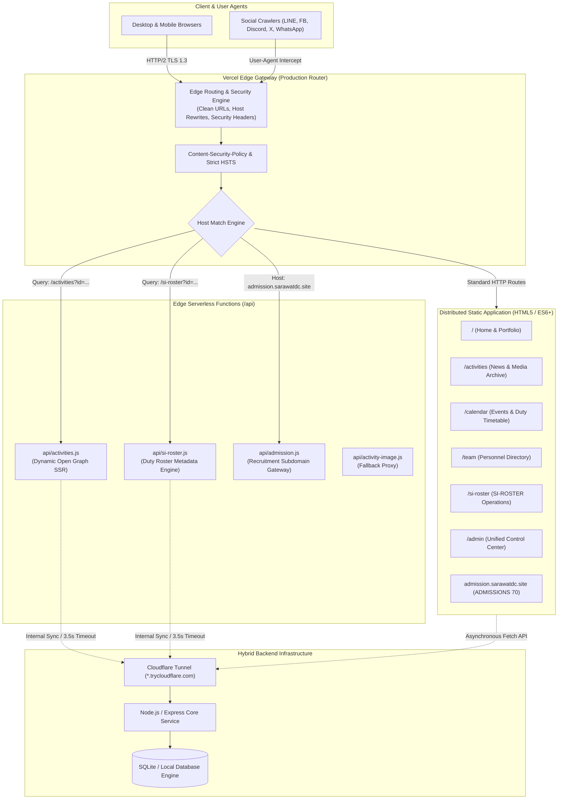

# 🛡️ SARAWAT DECHA — Enterprise Web Platform

[](https://www.sarawatdc.site/)
[](https://securityheaders.com/?q=https%3A%2F%2Fwww.sarawatdc.site%2F)
[](https://vercel.com)
[](https://www.sarawatdc.site/)
[](#license)

An enterprise-grade, high-performance web platform and digital operations ecosystem engineered for the **Student Inspector Organization (สารวัตรนักเรียน - Truant Patrol)**, Dechapattanayanukul School. 

The system provides end-to-end digital coordination including public media archives, multi-tier officer rosters, digital student admissions, dynamic social media Open Graph serverless rendering, and an offline-tolerant administration cockpit.

---

## 📐 System Architecture



---

## ⚡ Core Subsystems & Engineering Highlights

### 1. Public Experience Portal (`/`, `/activities`, `/calendar`, `/team`)
- **Diego Agency Minimalist System:** High-contrast Swiss architectural design layout with responsive Bento grids and glassmorphism micro-interactions.
- **Dynamic Media Archive:** Real-time search, categorization (`พิธีการสำคัญ`, `จิตอาสา`, `กิจกรรม`, `อบรมพัฒนา`), and multi-platform media routing (Facebook, Instagram Reels, Google Photos albums).
- **Dynamic Calendar Engine:** Automated chronological grouping with Buddhist era date normalization (`พ.ศ. 2569 - 2570`) and status indicators (`เปิดรับ`, `ใกล้หมดเวลา`, `ปิดรับแล้ว`).

### 2. SI-ROSTER — Duty Scheduling & Deployment System (`/si-roster`)
- **Real-Time Quota Orchestration:** Interactive duty booking with real-time slot decrementing, multi-duty constraints, and strict countdown timers.
- **Deep-Linking & History State Sync:** Query parameter binding (`?id=ACT_...`) synchronized with browser history (`pushState` / `replaceState`) allowing bookmarking and direct duty sharing.
- **Officer Operations Suite (`SI-ROSTER/admin.html`):** Bulk applicant moderation, single/bulk deletion, randomizer distribution engine, and client-side PDF export with UTF-8 Thai glyph metrics.
- **LINE In-App Browser Isolation:** Intelligent breakout guard (`js/line-browser-guard.js`) detecting LINE WebViews and directing users to system browsers to prevent cookie/session dropouts.

### 3. SARAWAT ADMISSIONS 70 (`admission.html`)
- Dedicated recruitment subdomain gateway (`https://admission.sarawatdc.site`).
- Automated countdown timers, live applicant status verification, criteria accordion, and dynamic recruitment switch control.

### 4. Edge Serverless & Dynamic Social Card SSR (`/api`)
Social crawlers (Facebook External Hit, LINE bot crawler, Discord bot, Twitterbot, WhatsApp) do not execute heavy client-side JavaScript. This platform leverages serverless edge handlers:
- **`api/activities.js`:** Intercepts crawler traffic for deep-linked activity URLs (`/activities?id=...`), fetches record data with abort controllers, strips markdown payloads, and synthesizes dynamic `<title>`, `<meta property="og:...">`, and Twitter Cards before returning compiled HTML.
- **`api/si-roster.js`:** Injects real-time duty title, stripped description, and JPEG meta cover banners on-the-fly for social preview generation.
- **Image Normalization:** Automated magic-byte verification (`FF D8 FF E0`) ensuring all preview images strictly maintain JPEG specifications under 300 KB to comply with LINE's strict 1 MB cache limits.

---

## 🔒 Enterprise Security & Compliance (Grade A+)

The platform scores a **Grade A+** rating on [SecurityHeaders.com](https://securityheaders.com/?q=https%3A%2F%2Fwww.sarawatdc.site%2F) through strict edge-enforced security directives:

| Header Directive | Configuration | Threat Mitigation |
| :--- | :--- | :--- |
| **Content-Security-Policy (CSP)** | `default-src 'self'; script-src 'self' 'unsafe-inline' 'unsafe-eval' https://cdn.jsdelivr.net https://cdnjs.cloudflare.com https://unpkg.com https://uicdn.toast.com; ...` | Mitigates Stored & Reflected Cross-Site Scripting (XSS) and unauthorized script injection. |
| **X-Frame-Options** | `SAMEORIGIN` | Completely prevents Clickjacking and UI redressing attacks. |
| **X-Content-Type-Options** | `nosniff` | Disables MIME-type sniffing; enforces strict content-type compliance. |
| **Strict-Transport-Security (HSTS)** | `max-age=63072000; includeSubDomains; preload` | Enforces zero-unencrypted HTTP connections across the apex domain and all subdomains for 2 years. |
| **Referrer-Policy** | `strict-origin-when-cross-origin` | Protects user privacy by stripping internal path parameters when routing to external destinations. |
| **Permissions-Policy** | `camera=(), microphone=(), geolocation=(), browsing-topics=()` | Hardware-level API sandbox blocking unauthorized camera, mic, or sensor probing. |
| **Cross-Origin-Opener-Policy (COOP)** | `same-origin-allow-popups` | Isolates browsing contexts while retaining clean popups for external social channels. |
| **Reverse Tabnabbing Protection** | `rel="noopener noreferrer"` | Audited and enforced on 100% of all outbound hyperlinks (`target="_blank"`). |

---

## 📂 Repository Anatomy

```text
├── .gitignore                      # Git exclusion rules (secrets, scratchpad, db)
├── README.md                       # Engineering documentation
├── vercel.json                     # Edge routing, redirects, headers, and reverse proxy
├── sync-to-github.bat              # Rapid multi-branch synchronization script
│
├── index.html                      # Landing & institutional portal
├── activities.html                 # News, announcements, and activity archive
├── calendar.html                   # Organizational operations calendar
├── team.html                       # Personnel hierarchy & generation archives
├── admission.html                  # SARAWAT ADMISSION 70 recruitment portal
├── admin.html                      # Unified core admin management cockpit
│
├── api/                            # Edge Serverless Functions (Node.js runtime)
│   ├── activities.js               # Dynamic SSR generator for activity deep-links
│   ├── activity-image.js           # Media streaming & fallback resolution proxy
│   ├── admission.js                # Subdomain host routing & crawler bridge
│   └── si-roster.js                # Dynamic Open Graph SSR for duty bookings
│
├── SI-ROSTER/                      # Standalone Duty Management Subsystem
│   ├── index.html                  # Public duty signup interface
│   ├── admin.html                  # Duty admin panel & scheduling controls
│   ├── css/style.css               # Isolated Roster CSS components
│   └── js/
│       ├── app.js                  # Duty calendar engine & business logic
│       ├── bridge.js               # API proxy & tunnel connectivity layer
│       └── line-browser-guard.js   # LINE WebView breakout handler
│
├── css/
│   └── diego.css                   # Diego Agency design tokens & global CSS variables
│
├── js/
│   ├── api-config.js               # Central API configuration & fallback controller
│   ├── cloudflare-config.js        # Dynamic Cloudflare Tunnel gateway definitions
│   ├── image-protection.js         # Anti-copy & hotlink prevention module
│   ├── main.js                     # Global DOM controllers & navigation handlers
│   ├── admin-recruitment.js        # Admissions review & applicant evaluation logic
│   └── admin-team.js               # Organization chart data persistence handler
│
└── assets/
    ├── icons/                      # Official institutional SVG & PNG marks
    └── images/                     # True JPEG (1920x1080) optimized cover banners
```

---

## 🛠️ Tech Stack & Dependencies

```text
Frontend Runtime        : Vanilla ES2022+, HTML5 Semantic Architecture
Styling Engine          : Pure CSS (Custom Properties, Grid & Flexbox, Backdrop Filters)
Typography Tokens       : Plus Jakarta Sans (Brand/Headers), Kanit (Thai UI), Outfit
Iconography             : Lucide Icons, FontAwesome 6 Pro CDN
Dialogs & UI Modals     : SweetAlert2 (v11)
Rich Text & Markdown    : Marked.js, Toast UI Editor
Edge & Serverless Infra : Vercel Edge Network, Serverless Node.js Handlers
Hybrid Data Tunnel      : Cloudflare Zero Trust (Tunnel daemon)
Local Database          : Node.js Express + SQLite / MySQL Driver
Security Tooling        : OWASP Security Headers, Magic Byte Verifiers
```

---

## 🚀 Local Development & Deployment

### 1. Clone & Run Locally
No build step or Node compilation is required for the static frontend. You can serve the project using any static HTTP server:

```bash
# Clone the repository
git clone https://github.com/Pansamcth/sarawat-home.git
cd sarawat-home

# Option A: Run using Python HTTP server
python -m http.server 8080

# Option B: Run using Node.js npx
npx serve . -p 8080
```

Navigate to `http://localhost:8080`.

### 2. Cloudflare Tunnel Gateway
For live data synchronization with the backend SQLite database:
1. Define the tunnel endpoint inside `cloudflare-config.js`:
   ```javascript
   _global.CLOUDFLARE_TUNNEL_URL = 'https://<your-tunnel-hash>.trycloudflare.com';
   ```
2. The client runtime automatically connects via fallback chains (`localhost:5000` -> LAN `192.168.x.x:5000` -> Cloudflare Tunnel).

### 3. Vercel Production Deployment
The repository is continuously deployed to Vercel upon pushing to the `main` branch:

```bash
git add .
git commit -m "feat(core): update subsystem"
git push origin main
```

Or execute the included automated synchronization tool on Windows:
```cmd
sync-to-github.bat
```

---

## 🌐 Production Domains

- **Official Web Portal:** [https://www.sarawatdc.site](https://www.sarawatdc.site)
- **Recruitment Gateway:** [https://admission.sarawatdc.site](https://admission.sarawatdc.site)
- **SI-ROSTER Duty System:** [https://www.sarawatdc.site/si-roster](https://www.sarawatdc.site/si-roster)

---

## 👨‍💻 Maintainers & Development

Developed and maintained by the **IT & Digital Technology Division**, Student Inspector Organization (สารวัตรนักเรียน), Dechapattanayanukul School.

- **Lead Engineer & Architect:** Rujira Wattanakitpaisal ([@Pansamcth](https://github.com/Pansamcth))
- **Email:** `rujira.wattanakitpaisal@gmail.com`

---

## 📄 License

Copyright &copy; 2026 **SARAWAT DECHAPATTANAYANUKUL**. All rights reserved.  
Unauthorized duplication, distribution, or decompilation of source assets without prior institutional consent is strictly prohibited.
