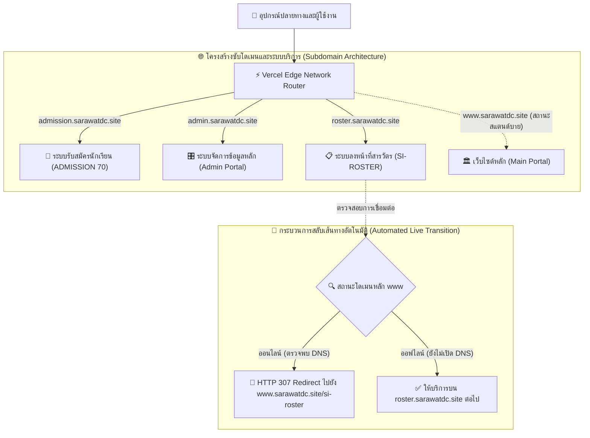

# 🏛️ สถาปัตยกรรมระบบและข้อกำหนดโครงสร้างเส้นทาง URL ✨
### System Architecture Specification & URL Routing Documentation 🌿
**คณะสารวัตรนักเรียน โรงเรียนเดชะปัตตนยานุกูล จังหวัดปัตตานี**  
*Student Inspector Organization, Dechapattanayanukul School, Pattani, Thailand*

---

## 1. 🌐 ภาพรวมสถาปัตยกรรมระบบ (System Architecture Overview)

ระบบสารสนเทศคณะสารวัตรนักเรียน โรงเรียนเดชะปัตตนยานุกูล ได้รับการออกแบบโครงสร้างสถาปัตยกรรมเครือข่ายและการให้บริการในรูปแบบ **Multi-Subdomain Isolation Topology** ภายใต้ชุดรหัสต้นฉบับเดี่ยว (Unified Monorepo) โดยมีระบบ Vercel Edge Network ทำหน้าที่เป็นเราเตอร์ขอบเครือข่าย (Edge Router) เพื่อควบคุมการกระจายคำขอ (Request Dispatching) คัดแยกสิทธิการเข้าถึง และแบ่งแยกขอบเขตภาระงานของแต่ละซับโดเมนอย่างเด็ดขาด ส่งผลให้สามารถบริหารจัดการ เปิด-ปิด หรือปรับปรุงระบบเฉพาะส่วนได้อย่างอิสระโดยไม่ส่งผลกระทบต่อระบบอื่น ✨

---

## 2. 🚦 สถานะการติดตั้งระบบในปัจจุบัน (Current Deployment Status)

> [!NOTE]
> **สถานะการปฏิบัติการ (Operational Status):**  
> โดเมนหลัก `sarawatdc.site` และ `www.sarawatdc.site` อยู่ในสถานะสแตนด์บาย (Standby Mode) โดยปลดระเบียน DNS ออกชั่วคราวเพื่อรอการเปิดตัวอย่างเป็นทางการ ในขณะที่ระบบรับสมัคร, ระบบแอดมินกลาง และระบบลงหน้าที่ ได้รับการเปิดระเบียน DNS ตรงไปยัง Edge Router เพื่อให้บริการแก่ผู้เกี่ยวข้องได้ทันทีอย่างราบรื่น 🚀

| โดเมน / ซับโดเมน | สถานะระเบียน DNS | วัตถุประสงค์การใช้งาน | ปลายทางระบบ (Target) |
| :--- | :---: | :--- | :--- |
| `admission.sarawatdc.site` | 🟢 **เปิดใช้งาน (Active)** | 🎒 ระบบรับสมัครสารวัตรนักเรียน ประจำปีการศึกษา 2570 | `admission.html` |
| `admin.sarawatdc.site` | 🟢 **เปิดใช้งาน (Active)** | 🎛️ ระบบบริหารจัดการข้อมูลและควบคุมเว็บไซต์หลัก | `admin.html` |
| `roster.sarawatdc.site` | 🟢 **เปิดใช้งาน (Active)** | 📋 ระบบลงเวลาและมอบหมายงานเวร (โอนย้ายสู่เว็บหลักอัตโนมัติ) | `SI-ROSTER/index.html` |
| `www.sarawatdc.site` | 🔴 **สแตนด์บาย (Standby)** | 🏛️ เว็บไซต์สารสนเทศหลัก (ไม่พบ DNS ในปัจจุบัน) | `index.html` |
| `sarawat-home.vercel.app` | 🧪 **ทดสอบภายใน (Internal)** | 💻 สภาพแวดล้อมทดสอบการทำงานข้ามระบบสำหรับผู้พัฒนา | ทุกระบบในโปรเจกต์ |

---

## 3. 🗺️ สารบบ URL และข้อกำหนดการกำหนดเส้นทาง (Complete URL Directory & Specifications)

### 3.1 🎒 ระบบรับสมัครสารวัตรนักเรียน (SARAWAT ADMISSION System)
* **ซับโดเมนให้บริการ:** `https://admission.sarawatdc.site`
* **โมดูลควบคุม:** `admission.html` ผ่าน Edge Handler `api/admission.js`
* **กลุ่มเป้าหมาย:** นักเรียนผู้สมัคร, คณะกรรมการตรวจสอบคุณสมบัติ

| รูปแบบ URL (URL Pattern) | ผลลัพธ์และพฤติกรรมการทำงานของระบบ |
| :--- | :--- |
| `https://admission.sarawatdc.site/` | เข้าสู่ระบบรับสมัครสารวัตรนักเรียนโดยตรง โดยแถบ Address bar แสดงเส้นทางเป็น `/` เพื่อความเรียบร้อยสวยงาม |
| `https://admission.sarawatdc.site/admission` | ประมวลผลผ่าน Serverless Function พร้อมจัดส่งข้อมูลเอกสารและส่วนติดต่อผู้ใช้ |
| `https://admission.sarawatdc.site/recruit` | เส้นทางย่อสำหรับการประชาสัมพันธ์และเผยแพร่ลงสื่อสังคมออนไลน์ |
| `https://admission.sarawatdc.site/?edit=<ID>` | เข้าสู่กระบวนการแก้ไขข้อมูลใบสมัครเฉพาะบุคคลสำหรับผู้สมัครที่ผ่านการส่งข้อมูลแล้ว 📝 |

---

### 3.2 🎛️ ระบบบริหารจัดการเว็บไซต์สำหรับผู้ดูแล (Main Administration System)
* **ซับโดเมนให้บริการ:** `https://admin.sarawatdc.site`
* **โมดูลควบคุม:** `admin.html` ผ่าน Edge Handler `api/admin.js`
* **กลุ่มเป้าหมาย:** ประธานสารวัตรนักเรียน, รองประธาน, ผู้ดูแลระบบสารสนเทศ (ต้องมีสิทธิ์ยืนยันตัวตน 🔐)

| รูปแบบ URL (URL Pattern) | ผลลัพธ์และพฤติกรรมการทำงานของระบบ |
| :--- | :--- |
| `https://admin.sarawatdc.site/` | Edge Router ส่งคำสั่ง HTTP 307 Redirect สู่ `/admin` และสคริปต์ปรับ URL แสดงผลเป็น `/` สะอาดตา |
| `https://admin.sarawatdc.site/admin` | โหลดหน้าระบบควบคุมหลัก การจัดการข่าวสาร และการตั้งค่าสวิตช์รับสมัคร |
| `https://www.sarawatdc.site/admin` | รองรับการเข้าถึงผ่านโดเมนหลักควบคู่กันเมื่อเปิดให้บริการเว็บไซต์หลักในอนาคต |

---

### 3.3 📋 ระบบลงหน้าที่และตารางเวรปฏิบัติงาน (SI-ROSTER Duty System)
* **ซับโดเมนชั่วคราว:** `https://roster.sarawatdc.site`
* **เส้นทางทางการเมื่อเปิดเว็บหลัก:** `https://www.sarawatdc.site/si-roster`
* **โมดูลควบคุม:** สารบบ `SI-ROSTER/` ผ่าน Edge Handler `api/si-roster.js`
* **กลุ่มเป้าหมาย:** สมาชิกสารวัตรนักเรียน, หัวหน้าฝ่ายเวรปฏิบัติหน้าที่

| รูปแบบ URL (URL Pattern) | ผลลัพธ์และพฤติกรรมการทำงานของระบบ |
| :--- | :--- |
| `https://roster.sarawatdc.site/` | โหลดระบบลงหน้าที่ SI-ROSTER (สลับการทำงานสู่เว็บหลักทันทีเมื่อเปิดใช้งาน DNS เว็บหลัก 🔄) |
| `https://roster.sarawatdc.site/?id=<ID>` | แสดงรายละเอียดภารกิจเวร พร้อมสร้างพรีวิว Open Graph สำหรับสื่อสารในแอปพลิเคชัน LINE 💬 |
| `https://roster.sarawatdc.site/admin` | ระบบจัดเวร มอบหมายงาน และบันทึกประวัติการปฏิบัติหน้าที่สำหรับผู้ดูแลเวร |
| `https://roster.sarawatdc.site/terms-of-service` | ข้อตกลงและเงื่อนไขการใช้บริการของระบบ SI-ROSTER (รองรับเส้นทางย่อ `/terms`, `/tos` 📄) |
| `https://roster.sarawatdc.site/privacy-policy` | นโยบายการคุ้มครองข้อมูลส่วนบุคคลของระบบ SI-ROSTER ตามมาตรฐาน PDPA (รองรับเส้นทางย่อ `/privacy`, `/pp` 🛡️) |

---

### 3.4 🏛️ ระบบสารสนเทศและเว็บไซต์ส่วนรวม (Main Information Portal)
* **โดเมนให้บริการ:** `https://www.sarawatdc.site` (เปิดใช้งานเต็มรูปแบบตามกำหนดการ 🎉)
* **กลุ่มเป้าหมาย:** คณะครู, นักเรียน, ผู้ปกครอง, บุคคลภายนอก

| รูปแบบ URL (URL Pattern) | ไฟล์ต้นทาง | วัตถุประสงค์และเนื้อหา |
| :--- | :--- | :--- |
| `https://www.sarawatdc.site/` | `index.html` | ข้อมูลประชาสัมพันธ์ทั่วไป วิสัยทัศน์ พันธกิจ และช่องทางติดต่อ 🏫 |
| `https://www.sarawatdc.site/activities` | `activities.html` | คลังข่าวสาร รายงานผลการปฏิบัติงาน และอัลบั้มภาพกิจกรรม 📸 |
| `https://www.sarawatdc.site/calendar` | `calendar.html` | ตารางกิจกรรม กำหนดการโรงเรียน และปฏิทินวาระงาน 📅 |
| `https://www.sarawatdc.site/team` | `team.html` | ทำเนียบโครงสร้างคณะทำงานสารวัตรนักเรียนประจำปีการศึกษา 👥 |
| `https://www.sarawatdc.site/terms-of-service` | `terms-of-service.html` | ข้อกำหนดและเงื่อนไขการใช้งานเว็บไซต์หลัก 📜 |
| `https://www.sarawatdc.site/privacy-policy` | `privacy-policy.html` | นโยบายการคุ้มครองข้อมูลส่วนบุคคลสำหรับเว็บไซต์หลัก 🔒 |
| `https://www.sarawatdc.site/warn/` | เชื่อมโยงภายนอก | ระบบรับแจ้งเหตุพฤติกรรมไม่เหมาะสมและข้อเสนอแนะ 📮 |

---

### 3.5 🧪 สภาพแวดล้อมสำหรับการทดสอบและการพัฒนา (Staging & Testing Environment)
* **URL ทดสอบ:** `https://sarawat-home.vercel.app`
* **ข้อกำหนดการทำงาน:** ระบบจะไม่เปลี่ยนเส้นทางข้ามโดเมนออกสู่ภายนอก ทำให้นักพัฒนาสามารถทดสอบความถูกต้องของการเชื่อมโยงระหว่างโมดูลต่างๆ ในสภาพแวดล้อม Sandbox ได้อย่างสะดวกสบาย 🛠️

---

## 4. 🛡️ มาตรการความมั่นคงปลอดภัยและการแยกขอบเขตโดเมน (Domain Isolation & Security Specifications)

เพื่อป้องกันมิให้ผู้ใช้งานสามารถเข้าถึงหน้าที่ยังไม่เปิดให้บริการอย่างเป็นทางการ (อาทิ หน้าเว็บหลัก และระบบเวรปฏิบัติหน้าที่) ผ่านทางซับโดเมนรับสมัคร ระบบได้ติดตั้งกลไกความปลอดภัยแบบหลายชั้น (Multi-Tier Defense):

> [!IMPORTANT]
> 1. 🧭 **การปรับเปลี่ยนลิงก์ขาออก (Client-side Link Rerouting):**  
>    - เมื่อผู้ใช้งานเปิดเว็บไซต์ผ่าน `admission.sarawatdc.site` ลิงก์เมนูนำทางทั้งหมด (เช่น หน้าแรก, ข่าวสาร, ปฏิทิน, คณะทำงาน) รวมถึงลิงก์ "ระบบลงหน้าที่ (SI-ROSTER)" ในส่วนท้ายของหน้า จะถูกแปลงค่าให้ชี้ตรงไปยัง `https://www.sarawatdc.site/...`
>    - ในระหว่างที่ยังไม่เปิด DNS เว็บหลัก ผู้ใช้งานที่คลิกลิงก์ดังกล่าวจะพบข้อผิดพลาด 404 (DNS Connection Failed) ทันทีตามข้อกำหนด
>
> 2. ⚡ **การควบคุมการเปลี่ยนเส้นทางระดับขอบเครือข่าย (Edge HTTP 307 Enforcement):**  
>    - หากผู้ใช้งานป้อน URL เองโดยตรง อาทิ `https://admission.sarawatdc.site/si-roster` หรือ `/activities` ตัวประมวลผล Vercel Edge Router จะตรวจจับชื่อ Host และทำการ Redirect (HTTP 307) ส่งผู้ใช้ออกไปยัง `https://www.sarawatdc.site/...` ทันที โดยไม่ยินยอมให้โหลดเนื้อหา
>    - หากผู้ใช้งานป้อน `/admin` บนหน้ารับสมัคร ระบบจะทำการส่งต่อไปยัง `https://admin.sarawatdc.site` อย่างถูกต้อง
>
> 3. 🔒 **การรักษาความปลอดภัยระดับโค้ดหน้าเว็บ (In-Page Subdomain Guard):**  
>    - หน้าเอกสารทั้งหมดในระบบ SI-ROSTER ได้รับการติดตั้งสคริปต์ตรวจสอบชื่อโฮสต์ในส่วน `<head>` หากพบว่าถูกโหลดภายใต้ซับโดเมน `admission.` จะทำการสลับเส้นทางออกไปยังโดเมนหลักทันทีภายในเสี้ยววินาที

---

## 5. 🔄 กลไกการตรวจจับและเปลี่ยนเส้นทางอัตโนมัติ (Automated Live Transition & Fallback Mechanism)

ในกรณีที่มีผู้ใช้งานบันทึกที่อยู่เว็บไซต์ **`https://roster.sarawatdc.site`** ไว้ เมื่อถึงกำหนดการเปิดตัวเว็บไซต์หลักและมีการเชื่อมต่อระเบียน DNS ของ `sarawatdc.site` และ `www.sarawatdc.site` เรียบร้อยแล้ว:

ระบบจะทำการส่งต่อผู้ใช้งานไปยัง **`https://www.sarawatdc.site/si-roster`** โดยอัตโนมัติ ด้วยกลไกตรวจสอบ 2 ระดับอย่างชาญฉลาด:

1. 📡 **การตรวจสอบระดับเซิร์ฟเวอร์ (Server-Side DNS Resolution):**  
   ฟังก์ชัน `api/si-roster.js` บน Vercel จะทำการตรวจสอบระเบียน DNS ของ `www.sarawatdc.site` ผ่านคำสั่ง `dns.lookup()` หากตรวจพบว่าโดเมนหลักเริ่มชี้มายังไอพีของระบบแล้ว จะทำการส่งรหัสตอบกลับ HTTP 307 Temporary Redirect พาผู้ใช้ไปยัง `www.sarawatdc.site/si-roster` พร้อมพ่วงพารามิเตอร์ทั้งหมดทันที
2. 🖼️ **การตรวจสอบระดับเบราว์เซอร์ (Client-Side Image Ping Fallback):**  
   ในส่วน `<head>` ของระบบ SI-ROSTER มีกระบวนการตรวจสอบสถานะการตอบสนองของไฟล์โลโก้บน `https://www.sarawatdc.site/assets/icons/sarawat-logo.png` หากดาวน์โหลดสำเร็จ แสดงว่าเว็บหลักพร้อมให้บริการแล้ว เบราว์เซอร์จะสั่งการ `window.location.replace()` เพื่อเปลี่ยนเส้นทางทันทีอย่างรวดเร็ว

---

## 6. 📊 ตารางสรุปการกำหนดเส้นทางและหน้าปลายทาง (Routing Matrix & Endpoint Reference)

| ที่อยู่ URL ที่เรียกเข้าชม | หน้าเอกสารปลายทาง | พฤติกรรมการประมวลผลของ Edge Router |
| :--- | :--- | :--- |
| `admission.sarawatdc.site/` | `admission.html` | แสดงผลระบบรับสมัคร (URL แสดง `/`) ✨ |
| `admission.sarawatdc.site/recruit` | `admission.html` | ปรับเส้นทางภายในเพื่อแสดงผลระบบรับสมัคร 🎒 |
| `admission.sarawatdc.site/si-roster` | `www.sarawatdc.site/si-roster` | HTTP 307 Redirect สู่เว็บหลัก (แสดงข้อผิดพลาด DNS 404) |
| `admission.sarawatdc.site/admin` | `admin.sarawatdc.site` | HTTP 307 Redirect ข้ามสู่ซับโดเมนแอดมิน 🎛️ |
| `admin.sarawatdc.site/` | `admin.html` | HTTP 307 Redirect สู่ `/admin` (URL แสดง `/`) 🔐 |
| `admin.sarawatdc.site/admin` | `admin.html` | แสดงผลระบบแอดมินหลัก |
| `admin.sarawatdc.site/si-roster` | `www.sarawatdc.site/si-roster` | HTTP 307 Redirect สู่เว็บหลัก (แสดงข้อผิดพลาด DNS 404) |
| `roster.sarawatdc.site/` | `SI-ROSTER/index.html` | แสดงผลระบบลงหน้าที่ (โอนย้ายสู่เว็บหลักอัตโนมัติเมื่อเปิด DNS 🔄) |
| `roster.sarawatdc.site/admin` | `SI-ROSTER/admin.html` | แสดงผลระบบจัดเวรสำหรับผู้ดูแล SI-ROSTER 📋 |
| `roster.sarawatdc.site/terms-of-service` | `SI-ROSTER/terms-of-service.html` | แสดงผลข้อตกลงการใช้บริการระบบลงหน้าที่ 📄 |
| `roster.sarawatdc.site/privacy-policy` | `SI-ROSTER/privacy-policy.html` | แสดงผลนโยบายการคุ้มครองข้อมูลส่วนบุคคลระบบลงหน้าที่ 🛡️ |
| `www.sarawatdc.site/` | `index.html` | แสดงผลหน้าแรกของเว็บไซต์หลัก (เมื่อเปิดระเบียน DNS) 🏫 |
| `www.sarawatdc.site/activities` | `activities.html` | แสดงผลคลังข่าวสารและภาพกิจกรรม (เมื่อเปิดระเบียน DNS) 📸 |
| `www.sarawatdc.site/calendar` | `calendar.html` | แสดงผลตารางกิจกรรมโรงเรียน (เมื่อเปิดระเบียน DNS) 📅 |
| `www.sarawatdc.site/team` | `team.html` | แสดงผลทำเนียบคณะทำงานสารวัตรนักเรียน (เมื่อเปิดระเบียน DNS) 👥 |
| `www.sarawatdc.site/admin` | `admin.html` | แสดงผลระบบแอดมินหลัก 🎛️ |
| `www.sarawatdc.site/si-roster` | `SI-ROSTER/index.html` | แสดงผลระบบลงหน้าที่สารวัตรนักเรียน 📋 |

---

## 7. 🚀 ขั้นตอนปฏิบัติการสำหรับผู้ดูแลระบบเมื่อเปิดใช้งานเว็บไซต์หลัก (Production Go-Live Procedures)

> [!TIP]
> **ขั้นตอนการเปิดใช้งานระบบสู่สาธารณะอย่างเป็นทางการ:**  
> 1. เข้าสู่ระบบจัดการโดเมน (Domain Registrar หรือ Cloudflare DNS) สำหรับโดเมน `sarawatdc.site`
> 2. ทำการเพิ่มระเบียน DNS ดังต่อไปนี้:
>    * **Type CNAME:** ชื่อระเบียน `www` กำหนดค่าปลายทางเป็น `cname.vercel-dns.com`
>    * **Type A:** ชื่อระเบียน `@` (Root Domain) กำหนดค่า IP เป็น `76.76.21.21`
> 3. เมื่อระบบเครือข่าย DNS กระจายตัวสมบูรณ์ (ปกติใช้เวลาประมาณ 1 ถึง 5 นาที):
>    * พอร์ทัลเว็บไซต์หลัก `https://www.sarawatdc.site` จะพร้อมให้บริการแก่สาธารณชนทันที 🎉
>    * ระบบ `roster.sarawatdc.site` จะทำการเปลี่ยนเส้นทางผู้ใช้งานเข้าสู่ `www.sarawatdc.site/si-roster` โดยอัตโนมัติในทันที โดยไม่ต้องแก้ไขไฟล์การตั้งค่าใดๆ เพิ่มเติม 🌟

---

💙 **คณะสารวัตรนักเรียน โรงเรียนเดชะปัตตนยานุกูล จังหวัดปัตตานี** 🇹🇭  
*งานเทคโนโลยีสารสนเทศและการสื่อสารองค์กร (Information Technology & Communications)*  
*Truant Patrol Organization, Dechapattanayanukul School*

