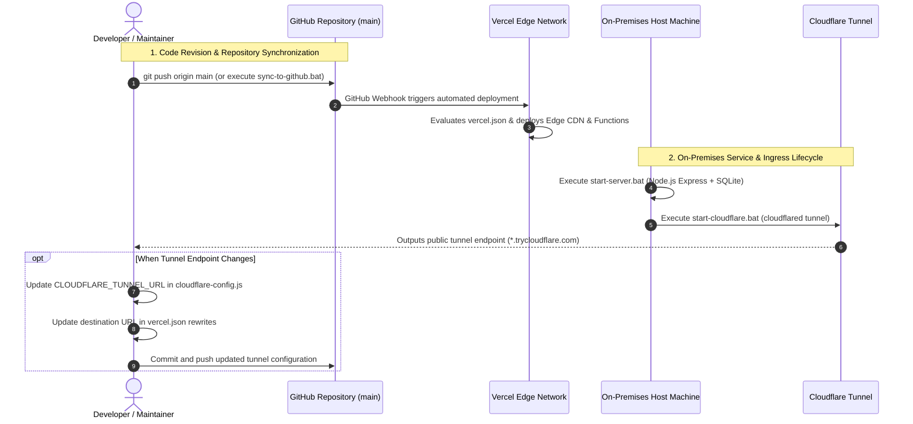

# 🛡️ SARAWAT DECHA — Student Inspector Information & Management System

Comprehensive production-grade technical documentation for the public portal, activities archive, SI-ROSTER duty assignment system, and recruitment platform of the Student Inspector Body at Dechapattanayanukul School, Mueang Pattani District, Pattani Province, Thailand.

---

## 1. Project Title & Description

**Project Name:** SARAWAT DECHA (Student Inspector System, Dechapattanayanukul School)  
**Organization:** Student Inspector Body / Truant Patrol, Dechapattanayanukul School  
**Affiliation:** Student Affairs Division, Dechapattanayanukul School  
**Repository:** [https://github.com/Pansamcth/sarawat-home](https://github.com/Pansamcth/sarawat-home)  

SARAWAT DECHA is a unified web-based enterprise information platform engineered for the student inspector organisation. It delivers public relation services, institutional disciplinary regulations, an interactive daily duty management and roster reservation system (SI-ROSTER), a candidate intake and qualification screening portal for prospective student inspectors, and an administrative cockpit for operations personnel. The platform utilizes a decoupled hybrid architecture comprising a globally distributed Edge Static & Serverless Frontend (Vercel Edge Network) and an on-premises Node.js / SQLite backend service bridged securely via an encrypted network tunnel.

---

## 2. System Overview & Objectives

1. **Public Experience & PR Portal:** Disseminates school news, announcements, activities, photo archives, and the official inspector hierarchy directory.
2. **SI-ROSTER Duty Management System:** Orchestrates daily duty shifts, quota allocations, real-time duty slot registration, personal shift histories, and countdown timers.
3. **Student Inspector Admissions (Academic Year 2570 / 2027):** Administers online candidate applications, GPAX academic eligibility validation, club affiliation quotas, Thai address cascading selection, and live application tracking.
4. **Unified Admin Management Cockpit:** Serves as a centralized administrative command panel for managing announcements, academic calendars, student inspector rosters, applicant screening, and feedback resolution.

---

## 3. Official URLs & Subsystems

| Subsystem / Service | Official Production URL | Primary Functionality |
| :--- | :--- | :--- |
| **Main Web Portal** | [https://www.sarawatdc.site/](https://www.sarawatdc.site/) | Homepage, organizational profile, mission statement, and inquiries |
| **News & Activities Archive** | [https://www.sarawatdc.site/activities](https://www.sarawatdc.site/activities) | Public news, official press releases, and photo album galleries |
| **Academic & Duty Calendar** | [https://www.sarawatdc.site/calendar](https://www.sarawatdc.site/calendar) | Operational calendar, institutional holidays, and scheduled duties |
| **Inspector Team Directory** | [https://www.sarawatdc.site/team](https://www.sarawatdc.site/team) | Executive committee, faculty advisors, and batch member directory |
| **SI-ROSTER Duty System** | [https://www.sarawatdc.site/si-roster](https://www.sarawatdc.site/si-roster) | Shift reservation, duty quota tracking, and personal roster status |
| **Admissions Subsystem** | [https://admission.sarawatdc.site/](https://admission.sarawatdc.site/) | New inspector intake, status tracking, and applicant data correction |
| **Unified Admin Cockpit** | [https://www.sarawatdc.site/admin](https://www.sarawatdc.site/admin) | Central administration: news, calendar, admissions, team, and feedback |
| **SI-ROSTER Admin Panel** | [https://www.sarawatdc.site/si-roster/admin](https://www.sarawatdc.site/si-roster/admin) | Duty creation, quota adjustments, member lists, and roster logs |

---

## 4. System Screenshots & Media Assets

All static visual branding and user interface assets are version-controlled within `assets/images/` and `assets/icons/`:

| Media Asset | File Path in Repository | Production Usage |
| :--- | :--- | :--- |
| **Student Inspector Insignia** | `assets/icons/sarawat-logo.png` | Official crest rendered in navigation bars, headers, and favicons |
| **School Institutional Crest** | `assets/icons/school-logo.png` | Dechapattanayanukul School emblem for official co-branding |
| **Main Hero Cover** | `assets/images/hero-main.jpg` | High-resolution banner image on the homepage hero section |
| **SI-ROSTER Cover** | `assets/images/si-roster-cover.jpg` | Header banner and Open Graph preview card for SI-ROSTER |
| **Admissions Cover** | `assets/images/recruit-cover.jpg` | Visual header for the 2570 student intake portal |
| **Activities Banner** | `assets/images/activities-cover.jpg` | Archive header and default fallback thumbnail for unillustrated news |
| **Calendar Banner** | `assets/images/calendar-cover.jpg` | Header graphic for the school event and calendar view |
| **Team Directory Banner** | `assets/images/team-cover.jpg` | Header banner for the executive committee and member roster |

---

## 5. Feature Matrix & Development Status

Development status categorized strictly against verified codebase inspection:

| Subsystem / Feature | Capability Description | Development Status |
| :--- | :--- | :---: |
| **News & Activities Portal** | Full-text search, category filters (`Ceremony`, `Volunteering`, `Activity`, `Training`), external photo album redirects | **Verified Active** |
| **Academic Calendar** | 7-day responsive grid (Sun–Sat), category badges, event metadata modals, and holiday markers | **Verified Active** |
| **Member Directory** | Hierarchical presentation of leadership, teachers/advisors, and batch membership rosters | **Verified Active** |
| **Student Feedback Portal** | Public inquiry and grievance submission with lifecycle tracking (`pending`, `in_progress`, `resolved`) | **Verified Active** |
| **SI-ROSTER Slot Sign-up** | Real-time shift booking with server-side quota checks, deadline enforcement, and countdown timers | **Verified Active** |
| **My Duties Status Check** | Personal shift lookups partitioned into separate `[Upcoming]` and `[Past / Completed]` tab views | **Verified Active** |
| **LINE In-App WebView Guard** | Detection of embedded LINE browser environments with automated guidance to breakout into native browsers | **Verified Active** |
| **Admissions Intake 2570** | Multi-step candidate registration, GPAX validation, club quotas, and cascading Thai address selection | **Verified Active** |
| **Application Tracking & Correction** | Live application status lookup via Student ID with telephone-verified record unlocking for amendments | **Verified Active** |
| **Edge Open Graph SSR** | Vercel Serverless Functions intercepting social bot crawlers to inject dynamic Open Graph / Twitter Card tags | **Verified Active** |
| **Admin Access & RBAC** | Token-based authentication with differentiated Superadmin and Admin role permissions | **Verified Active** |
| **Applicant Excel Export** | Exporting applicant datasets into structured `.xlsx` workbooks filtered by status and grade level | **Verified Active** |
| **Roster Slot Randomizer** | Automated randomized distribution algorithm for filling vacant duty slots with eligible members | **Code Present (Unconfirmed)** |
| **Roster PDF Report Generator** | Exporting printable roster assignment sheets formatted with Thai typography via client-side PDF renderers | **Code Present (Unconfirmed)** |
| **Cloudflare Named Tunnel** | High-availability permanent Cloudflare Zero Trust Tunnel routing `api.sarawatdc.site` to local Node.js backend | **Verified Active** |
| **Automated LINE Push Notifications** | Push notifications dispatching instant duty alerts and candidate submission receipts via LINE Messaging API | **Planned for Future** |
| **Fully Managed Cloud Database** | Migrating the standalone SQLite database to a managed high-availability cloud database cluster | **Planned for Future** |

---

## 6. System Architecture

SARAWAT DECHA operates on a decoupled hybrid infrastructure model:

- **Frontend & Edge Routing Layer:** Pure static HTML5/CSS3/ES2022+ files hosted on the Vercel Edge Network, paired with Vercel Serverless Functions (`api/*`) handling on-demand Open Graph Server-Side Rendering (SSR) for social media crawlers.
- **Secure Ingress & Tunnel Layer:** Cloudflare handles authoritative DNS resolution for `sarawatdc.site`. An encrypted outbound Cloudflare Tunnel establishes a secure bridge from the on-premises host to external clients without opening inbound firewall ports.
- **Backend Application & Persistence Layer:** An on-premises Node.js Express server running on port `5000` executing business logic, input validation, and interacting with a local SQLite database (`sarawat.db`) via the native `node:sqlite` engine configured in Write-Ahead Logging (WAL) mode.

```mermaid
flowchart TD
    subgraph Clients["1. Clients & External Crawlers"]
        UserBrowser["User Web Browser\n(Desktop & Mobile Devices)"]
        LineApp["LINE In-App Browser\n(with Breakout Guard)"]
        SocialCrawlers["Social Bots & Crawlers\n(LINE, Facebook, Twitter, Discord)"]
    end

    subgraph VercelEdge["2. Vercel Edge Platform (sarawatdc.site)"]
        EdgeRouter["Vercel Edge Router & Headers\n(HSTS, CSP, X-Frame-Options, Clean URLs)"]
        
        subgraph StaticPages["Static Web Applications"]
            P_Home["/ (Landing Page)"]
            P_Activities["/activities (News & Events)"]
            P_Calendar["/calendar (School Calendar)"]
            P_Team["/team (Member Directory)"]
            P_Admission["/admission (Intake 2570)"]
            P_Roster["/si-roster (Duty Roster)"]
            P_Admin["/admin & /si-roster/admin"]
        end

        subgraph EdgeFunctions["Vercel Serverless Functions (/api)"]
            Fn_Activities["api/activities.js\n(SSR Activity Open Graph)"]
            Fn_Roster["api/si-roster.js\n(SSR Roster Open Graph)"]
            Fn_Admission["api/admission.js\n(SSR Admissions Open Graph)"]
            Fn_ImgProxy["api/activity-image.js\n(Base64 Image Proxy)"]
        end
    end

    subgraph TunnelLayer["3. Secure Gateway & Ingress"]
        CFTunnel["Cloudflare Named Tunnel Daemon (cloudflared)\n(api.sarawatdc.site CNAME)"]
    end

    subgraph OnPremBackend["4. On-Premises Backend & Database"]
        ExpressServer["Node.js / Express Server (Port 5000)\n- Sliding-window Rate Limiter & Honeypots\n- Session-Token Authentication Middleware\n- Multer & Sharp High-Performance Image Pipeline"]
        
        subgraph APIRouters["Express Service Routers"]
            R_Core["Core Router\n(/api/news, /api/events, /api/feedbacks)"]
            R_Recruit["Recruitment Router\n(/api/recruitment/*)"]
            R_Roster["Roster Router\n(/api/roster/*)"]
        end

        subgraph LocalStorage["Persistence Storage"]
            SQLiteDB[("SQLite Database\n(sarawat.db via node:sqlite WAL Mode)")]
            UploadsDir["Uploaded Media Directory\n(uploads/)"]
        end
    end

    UserBrowser -->|HTTPS TLS 1.3| EdgeRouter
    LineApp -->|HTTPS TLS 1.3| EdgeRouter
    SocialCrawlers -->|User-Agent Interception| EdgeRouter

    EdgeRouter -->|Standard Web Route| StaticPages
    EdgeRouter -->|Bot Detected| EdgeFunctions
    
    StaticPages -.->|API Requests via Bridge| CFTunnel
    EdgeFunctions -.->|Preview Data Fetch (3.5s Timeout)| CFTunnel

    CFTunnel -->|HTTP localhost:5000| ExpressServer
    ExpressServer --> APIRouters
    APIRouters --> SQLiteDB
    APIRouters --> UploadsDir
```

---

## 7. Verified Technology Stack

### Frontend Client
- **Architecture:** Semantic HTML5, Vanilla JavaScript (ES2022+), CSS3 with CSS Custom Properties and Bento Grid layouts.
- **Design System:** Diego Minimalist Design System (`css/diego.css`).
- **Typography:** Google Fonts (`Plus Jakarta Sans`, `Kanit`, `Outfit`).
- **Iconography:** Lucide Icons (CDN), FontAwesome 6 (CDN).
- **UI Tooling:** SweetAlert2 (`v11`), Marked.js, Toast UI Editor.
- **API Communication Bridge:** `js/api-config.js`, `cloudflare-config.js`, `js/bridge.js`.

### Edge Serverless Layer (Vercel Functions)
- **Runtime:** Node.js Serverless Functions on Vercel Edge.
- **Core Function:** Intercepts crawler HTTP requests, dynamically inspects target resources, and compiles Open Graph / Twitter Card `<meta>` tags into HTML responses before returning to social bots.

### Backend Application Service
- **Runtime Environment:** Node.js (v22.x+ with native `node:sqlite`).
- **HTTP Framework:** Express.js (`v5.2.1`).
- **File Ingestion:** Multer (`v2.4.0`) handling `multipart/form-data`.
- **Image Transformation Pipeline:** Sharp (`v0.35.5`) converting uploads to compressed, web-optimized WebP/JPEG formats.
- **Workbook Processing:** SheetJS / XLSX (`v0.18.5`) for compiling applicant rosters into spreadsheet exports.
- **Security & Traffic Shaping:** CORS (`v2.8.6`), sliding-window in-memory rate limiters, and anti-spam honeypot fields.
- **Tunnel Client:** Cloudflare Tunnel (`cloudflared`) exposing internal port `5000` via TLS 1.3.

### Database Persistence Engine
- **Primary Database:** SQLite (`sarawat.db`) managed via `node:sqlite` (`DatabaseSync`) in Write-Ahead Logging (WAL) mode for concurrent read operations.
- **Storage Subsystem:** Local single-file database engine backed by an adjacent `uploads/` directory for physical image files.

---

## 8. Project Structure & Key Files

```text
f:\MP\ (Root Repository)
├── .vercel/                        # Vercel deployment metadata
├── api/                            # Vercel Serverless Functions for Social Crawler SSR
│   ├── activities.js               # Dynamic Open Graph generator for news and events
│   ├── activity-image.js           # Base64 image proxy and image resizing relay
│   ├── admission.js                # Subdomain router for admission.sarawatdc.site
│   ├── admissions.js               # Plural route alias (/admissions)
│   └── si-roster.js                # Dynamic Open Graph generator for SI-ROSTER duties
│
├── assets/                         # Static visual media and database assets
│   ├── data/
│   │   └── thai-address.json       # Thai administrative division database (subdistrict/district/province/zip)
│   ├── icons/                      # Official organization insignia and crests
│   └── images/                     # Hero banners, fallback images, and preview thumbnails
│
├── css/                            # System stylesheets
│   ├── diego.css                   # Diego Minimalist design tokens and bento grid layout
│   ├── roster.css                  # UI components for SI-ROSTER
│   ├── style.css                   # Base global styles and typography
│   └── team-page.css               # Specialized styles for the member directory
│
├── js/                             # Client-side business logic
│   ├── admin-recruitment.js        # Admin applicant screening, status transitions, and search
│   ├── admin-team.js               # Member directory management script
│   ├── api-config.js               # Universal API endpoint registry (window.SarawatApi)
│   ├── bridge.js                   # Proxy adapter translating google.script.run into HTTP POST
│   ├── cloudflare-config.js        # Active Cloudflare Tunnel endpoint configuration
│   ├── image-protection.js         # Client-side asset protection against unauthorized saving
│   ├── main.js                     # Global UI controllers, navigation menu, and modal handlers
│   ├── roster.js                   # Core client controllers for SI-ROSTER duty operations
│   └── skeletons.js                # Skeleton shimmer loaders matching concrete DOM nodes
│
├── SI-ROSTER/                      # SI-ROSTER subsystem directory
│   ├── admin.html                  # Admin console for SI-ROSTER supervisors
│   ├── index.html                  # Public duty booking and personal shift verification view
│   ├── css/style.css               # Local stylesheet for SI-ROSTER
│   └── js/
│       ├── app.js                  # Legacy calendar and shift calculation logic
│       ├── bridge.js               # Subsystem-level google.script.run proxy adapter
│       └── line-browser-guard.js   # LINE in-app browser breakout detection script
│
├── activities.html                 # News archive and photo album catalog
├── admin.html                      # Unified Administrative Cockpit
├── admission.html                  # Student Inspector Admissions 2570 portal
├── calendar.html                   # School academic and duty calendar
├── cloudflare-config.js            # Root tunnel resolution configuration
├── index.html                      # Organization portal homepage (Landing Page)
├── llms.txt                        # AI agent navigation manifest
├── llms-full.txt                   # Complete system technical context for LLMs
├── robots.txt                      # Web crawler indexing policies
├── sitemap.xml                     # Search engine XML sitemap
├── sync-to-github.bat              # Batch automation pushing commits across all active git branches
├── team.html                       # Student inspector hierarchy and batch roster
└── vercel.json                     # Vercel configuration (Security Headers, Routing, Rewrites)
```

---

## 9. Prerequisites & Tooling Versions

- **Host Operating System:** Windows 10/11, macOS, or modern Linux distribution.
- **Node.js Environment:** Version `22.x` or higher (mandatory requirement for built-in `node:sqlite` support).
- **Static HTTP Server (for local frontend development):** Python 3 (`http.server`), Node.js (`npx serve`), or VS Code Live Server.
- **Cloudflare Tunnel Daemon:** `cloudflared` executable (required if exposing local backend services to the live internet).

---

## 10. Frontend Installation & Local Setup

Because the frontend is built entirely with Vanilla JavaScript and Semantic HTML5 without requiring bundling or transpilation, it can be served instantly:

```bash
# 1. Clone the repository
git clone https://github.com/Pansamcth/sarawat-home.git
cd sarawat-home

# 2. Launch a local static HTTP server
# Option A: Using Python 3
python -m http.server 8080

# Option B: Using Node.js npx serve
npx serve . -p 8080
```

Access the application in your browser at `http://localhost:8080`.

---

## 11. Backend Installation & Local Setup

The backend service (`sarawat-backend`) provides the REST API and operates the local SQLite database:

```bash
# 1. Navigate to the backend directory
cd C:/Users/Administrator/Desktop/sarawat-backend

# 2. Install production dependencies
npm install

# 3. Start the Node.js server
node server.js
```

### Windows Automated Launch:
The backend directory includes an automated launch script:
- Double-click `START-ALL.bat` to launch the **Express Server Engine** and the **Dashboard Monitor** simultaneously in dedicated console windows.

---

## 12. Configuration & Environment Variables

### Frontend Configuration (`cloudflare-config.js`)
Configured via `cloudflare-config.js` and `SI-ROSTER/js/bridge.js`:
- `CLOUDFLARE_TUNNEL_URL`: Sets the active external URL (e.g., `https://xxxx.trycloudflare.com`). The built-in `resolveApiBase()` function resolves routes dynamically:
  - If loaded from `localhost` / `127.0.0.1` &rarr; targets `http://localhost:5000`
  - If loaded from a local network IP &rarr; targets port `5000` of the host machine
  - If loaded from a production domain or Vercel &rarr; routes through `CLOUDFLARE_TUNNEL_URL`

### Vercel Edge Configuration (`vercel.json`)
The Edge router contains rewrite rules that proxy requests matching `/api/:path*` and `/uploads/:path*` directly to the active tunnel:
```json
{
  "source": "/api/:path*",
  "destination": "https://api.sarawatdc.site/api/:path*"
}
```

### Backend Configuration
- `PORT`: Network listener port (default: `5000`).
- `sarawat.db`: SQLite database file located in the root of the backend directory.
- `uploads/`: Physical directory storing user-submitted images and candidate photographs.

---

## 13. API Documentation

The backend service exposes RESTful endpoints organized by operational domain:

### 13.1 Core & Public System APIs

| HTTP Method | Endpoint Path | Authorization | Request Body / Response Format |
| :--- | :--- | :---: | :--- |
| `GET` | `/api/health` | Public | Checks server health and database connectivity |
| `GET` | `/api/news` | Public | Retrieves all news articles and announcements |
| `POST` | `/api/news` | Admin Token | Creates/updates news (`{ id, tag, title, date, desc, image }`) |
| `DELETE` | `/api/news/:id` | Admin Token | Removes a news entry by ID |
| `GET` | `/api/events` | Public | Retrieves calendar events and school activities |
| `POST` | `/api/events` | Admin Token | Creates or updates an event entry |
| `DELETE` | `/api/events/:id` | Admin Token | Removes an event entry by ID |
| `POST` | `/api/upload` | Admin Token | Uploads an image (`multipart/form-data: image`, processed by Sharp) |
| `POST` | `/api/feedbacks` | Public (Rate-Limited) | Submits feedback/complaint (includes honeypot field `website_hp`) |
| `GET` | `/api/feedbacks` | Admin Token | Retrieves all submitted feedback entries |
| `PATCH` | `/api/feedbacks/:id` | Admin Token | Updates feedback lifecycle status (`status`, `adminNotes`) |

### 13.2 Administrative Authentication APIs

| HTTP Method | Endpoint Path | Authorization | Request Body / Response Format |
| :--- | :--- | :---: | :--- |
| `GET` | `/api/admins/setup-status` | Public | Checks whether the initial superadmin has been initialized |
| `POST` | `/api/admins/setup` | Public (One-time) | Initializes the primary Superadmin account |
| `POST` | `/api/login` | Public (5 req/15 min) | Authenticates admin credentials (`{ username, password }`), returns `{ success, token, user, role }` |
| `POST` | `/api/logout` | Authenticated | Revokes the current session token |
| `GET` | `/api/auth/verify` | Bearer Token | Verifies the validity of the current session token |
| `GET` | `/api/admins` | Superadmin Only | Lists all registered administrator accounts |
| `POST` | `/api/admins` | Superadmin Only | Registers a new administrator account |
| `DELETE` | `/api/admins/:id` | Superadmin Only | Deletes an administrator account |

### 13.3 Admissions & Candidate Ingestion APIs

| HTTP Method | Endpoint Path | Authorization | Request Body / Response Format |
| :--- | :--- | :---: | :--- |
| `GET` | `/api/recruitment/status` | Public | Checks admissions intake status, deadlines, and GPAX requirements |
| `GET` | `/api/recruitment/clubs` | Public | Retrieves available clubs and remaining intake quotas |
| `POST` | `/api/recruitment/apply` | Public (Rate-Limited) | Submits candidate application (`multipart/form-data` with photo) |
| `GET` | `/api/recruitment/check-status/:studentId` | Public | Retrieves application status for a given Student ID |
| `POST` | `/api/recruitment/unlock-correction` | Public | Verifies student identity to unlock application editing |
| `PUT` | `/api/recruitment/correction/:studentId` | Public | Submits revised application data |
| `GET` | `/api/recruitment/stats` | Admin Token | Retrieves admissions statistics categorized by status and grade |
| `GET` | `/api/recruitment/applicants` | Admin Token | Lists all applicants with search, filtering, and pagination |
| `PUT` | `/api/recruitment/applicant/:id/status` | Admin Token | Updates candidate status (`approved`, `rejected`, `need_correction`) |
| `GET` | `/api/recruitment/export` | Admin Token | Generates and downloads an Excel spreadsheet (`.xlsx`) of applicants |

### 13.4 SI-ROSTER Duty System APIs (Bridge RPC)

All SI-ROSTER requests are dispatched via HTTP POST to `/api/roster/:method` with payload `{ args: [ ... ] }` to maintain complete backward compatibility with Google Apps Script's `google.script.run` interface:

| Method Name | Arguments Payload | Access Level | Description |
| :--- | :--- | :---: | :--- |
| `getAppInitData` | `[]` | Member | Fetches configuration, duty definitions, student lists, and upcoming duties |
| `getAllActivities` | `[]` | Member | Retrieves all duty activities |
| `getSignupsForActivity` | `[sheetName]` | Member | Retrieves signed-up members for a specific duty activity |
| `saveSignup` | `[sheetName, name, duty, studentObj, optAdmin]` | Member/Admin | Records a duty shift booking, validating quotas and deadlines |
| `deleteSignup` | `[sheetName, id]` | Admin | Deletes an individual duty registration record |
| `bulkDeleteSignups` | `[sheetName, ids]` | Admin | Deletes multiple registration records in bulk |
| `checkStudentStatus` | `[studentName]` | Member | Retrieves personal shifts for a member, split into upcoming and past |
| `getAllUpcomingSignups` | `[]` | Admin | Fetches all member registrations across all upcoming duty shifts |
| `saveActivity` | `[activityData]` | Admin | Creates or updates a duty activity specification |
| `deleteActivity` | `[sheetName]` | Admin | Deletes a duty activity from the database |
| `randomizeSignups` | `[sheetName, duty, count]` | Admin | Automatically randomizes and fills unallocated duty slots |

---

## 14. Authentication & Role-Based Access Control (RBAC)

### Access Control Tiers
1. **Public / Students:**
   - Unrestricted access to news, calendar, own duty lookups, and candidate applications.
   - Guarded by in-memory rate limiting and invisible honeypot anti-spam verification.
2. **Student Inspector Members:**
   - Permitted to register for roster duty shifts based on pre-registered names in the roster database.
3. **Administrators (Admin):**
   - Granted operational authority to manage news, calendar events, duty schedules, and review applicants.
4. **Super Administrators (Super Admin):**
   - Unrestricted administrative rights, including managing other administrator accounts and credentials.

### Server-Side Security Model
- Successful logins generate a high-entropy 64-byte random hex token (`crypto.randomBytes(32).toString('hex')`) persisted in the `admin_sessions` table with a 24-hour expiration window.
- Protected endpoints mandate the presence of the HTTP header `Authorization: Bearer <token>`.
- **Architectural Boundary:** Client-side UI element concealment (such as `style="display:none;"`) is treated strictly as an interface courtesy. True enforcement occurs exclusively at the server level via the `authenticateAdmin` and `requireSuperAdmin` middlewares.

---

## 15. Cloudflare & Vercel Network Architecture

### Cloudflare (Free Tier)
- **Authoritative DNS:** Resolves `sarawatdc.site` and `admission.sarawatdc.site` to Vercel edge IP clusters.
- **Cloudflare Tunnel (`cloudflared`):** Forms an encrypted outbound WebSocket connection from the on-premises machine, routing external traffic to port `5000` without requiring public IP leases or router port-forwarding.

### Vercel Platform
- **Edge Static CDN:** Serves HTML, CSS, JavaScript, and asset files globally with low latency.
- **Security Headers (`vercel.json`):**
  - `Content-Security-Policy`: Restricts scripts, styles, fonts, and API origins.
  - `Strict-Transport-Security`: Enforces HTTPS across subdomains with HSTS preload.
  - `X-Frame-Options: SAMEORIGIN`: Prevents UI redressing and clickjacking.
  - `X-Content-Type-Options: nosniff`: Enforces strict MIME typing.
- **Reverse Proxy Rewrites:** Transparently redirects `/api/*` and `/uploads/*` requests to the active Cloudflare Tunnel target.

---

## 16. Database Schema

The persistence layer uses a local SQLite database (`sarawat.db`) with 20 audited tables:

```text
                                [sarawat.db - SQLite Schema]

  +-----------------------+       +-------------------------+       +------------------------+
  |         news          |       |         events          |       |     featured_event     |
  +-----------------------+       +-------------------------+       +------------------------+
  | id (TEXT PK)          |       | id (TEXT PK)            |       | id (INTEGER PK)        |
  | tag (TEXT)            |       | day, month, weekday     |       | title, desc, location  |
  | title (TEXT)          |       | category, category_label|       | date_start, date_end   |
  | desc, image (TEXT)    |       | title, time, location   |       | updated_at (TEXT)      |
  | views (INTEGER)       |       | date_start, date_end    |       +------------------------+
  | created_at, updated_at|       | created_at (TEXT)       |
  +-----------------------+       +-------------------------+

  +-----------------------+       +-------------------------+       +------------------------+
  |        admins         |       |     admin_sessions      |       |        settings        |
  +-----------------------+       +-------------------------+       +------------------------+
  | id (INTEGER PK)       |       | token (TEXT PK)         |       | setting_key (TEXT PK)  |
  | username (TEXT)       |       | admin_id (INTEGER)      |       | setting_value (TEXT)   |
  | password (TEXT)       |       | username, role (TEXT)   |       +------------------------+
  | role (TEXT)           |       | expires_at, created_at  |
  +-----------------------+       +-------------------------+

  +-----------------------+       +-------------------------+       +------------------------+
  |       feedbacks       |       |  recruitment_settings   |       |   recruitment_clubs    |
  +-----------------------+       +-------------------------+       +------------------------+
  | id (TEXT PK)          |       | id (INTEGER PK)         |       | id (INTEGER PK)        |
  | type, category (TEXT) |       | academic_year, is_open  |       | type, name (TEXT)      |
  | title, detail (TEXT)  |       | start_datetime, end_date|       | quota, is_active (INT) |
  | sender_name, contact  |       | min_gpax (REAL)         |       | created_at (TEXT)      |
  | status, admin_notes   |       | allowed_grades (TEXT)   |       +------------------------+
  +-----------------------+       +-------------------------+

  +------------------------------------------------------------------------------------------+
  |                                        applicants                                        |
  +------------------------------------------------------------------------------------------+
  | id (INTEGER PK)                                                                          |
  | application_code, student_id, prefix, first_name, last_name, grade_level, classroom (TEXT)|
  | phone, gpax (REAL), club, affiliation, photo_url (TEXT)                                  |
  | house_no, village_no, building, soi, road, subdistrict, district, province, postal_code   |
  | pdpa_consent (INT), consent_timestamp, status, admin_notes, correction_note, created_at   |
  +------------------------------------------------------------------------------------------+
          |
          +---> applicant_status_history (id, applicant_id, previous_status, new_status, changed_by)
          +---> recruitment_logs (id, action, actor, target_id, details, ip_address, created_at)

  +------------------------------------------------------------------------------------------+
  |                                    roster_activities                                     |
  +------------------------------------------------------------------------------------------+
  | id (INTEGER PK)                                                                          |
  | date, title, description, duties (JSON/TEXT), sheet_name, deadline, start_time, view_mode|
  | end_date, allow_multiple_duties (INT), creator_name                                      |
  +------------------------------------------------------------------------------------------+
          |
          +---> roster_signups (id, activity_id, duty_name, student_name, student_grade, timestamp)
          +---> roster_activity_logs (id, admin_name, action_type, activity_name, details, timestamp)

  +-----------------------+       +-------------------------+       +------------------------+
  |    roster_students    |       |      roster_duties      |       |     roster_admins      |
  +-----------------------+       +-------------------------+       +------------------------+
  | id (INTEGER PK)       |       | id (INTEGER PK)         |       | id (INTEGER PK)        |
  | name (TEXT)           |       | name (TEXT)             |       | username, password     |
  | grade (TEXT)          |       | quota, order_index (INT)|       | name, role (TEXT)      |
  +-----------------------+       +-------------------------+       +------------------------+
```

---

## 17. Backup & Restore Procedures

1. **Database-Level SQLite Backup:**
   - Copy `sarawat.db` alongside its WAL journal files (`sarawat.db-wal`, `sarawat.db-shm`) while the service is paused, or trigger the SQLite Online Backup API:
     ```bash
     sqlite3 sarawat.db ".backup 'sarawat-backup.db'"
     ```
   - Previous system snapshots are archived locally as `sarawat.db.bak`.
2. **Administrative UI Backup (`tab-backup`):**
   - The Unified Admin Cockpit provides a JSON data export feature encompassing news items, calendar schedules, and global settings.
   - Restorations can be performed by re-importing the structured JSON backup file through the administrative console.

---

## 18. System Testing & Verification

1. **Backend Service Health Check:**
   ```bash
   curl -i http://localhost:5000/api/health
   # Expected result: HTTP 200 OK with server uptime and database connection metrics
   ```
2. **Admissions Subsystem Verification:**
   ```bash
   curl -i http://localhost:5000/api/recruitment/status
   ```
3. **SI-ROSTER Bridge RPC Verification:**
   ```bash
   curl -X POST http://localhost:5000/api/roster/getAppInitData \
     -H "Content-Type: application/json" \
     -d "{\"args\":[]}"
   ```
4. **Automated Test Suites:**
   - Dedicated diagnostic scripts are maintained in the `scratch/` workspace directory, including `test-api.js`, `test_roster_execution.js`, and `test_recruit_comprehensive.js`.

---

## 19. Troubleshooting & FAQ

| Symptom / Error | Probable Root Cause | Resolution Procedure |
| :--- | :--- | :--- |
| **"Unable to connect to server" banner displayed** | 1. Backend Node.js process is stopped.<br>2. Cloudflare Tunnel was restarted with a new URL. | 1. Ensure `server.js` is running on port `5000`.<br>2. Inspect `cloudflared` console, copy the new URL, and update `cloudflare-config.js` and `vercel.json`. |
| **Port 5000 conflict (`EADDRINUSE`)** | An orphaned Node.js process is occupying port 5000. | The server script incorporates automated process termination. If it persists, run `taskkill /f /im node.exe` in PowerShell. |
| **Images or candidate photos fail to load** | Stored image URIs reference expired legacy Discord links. | The application automatically falls back to `assets/images/activities-cover.jpg`. Re-upload images through the Admin Cockpit to store them locally. |
| **LINE in-app browser reloads or drops input** | Embedded LINE WebView restrictions regarding cookies and navigation. | Handled automatically by `line-browser-guard.js`, which guides users to open the page in their device's default external browser. |
| **Social media cards show incorrect previews** | Crawlers cannot execute client-side JavaScript. | Verify that Vercel Serverless Functions (`api/activities.js`, `api/si-roster.js`) are active and images do not exceed social platform payload limits (1 MB). |

---

## 20. Deployment Workflow



---

## 21. Security Analysis & Known Technical Limitations

### Critical Security Recommendations
1. **Permanent Named Tunnel Architecture:** The system has successfully transitioned from ephemeral Quick Tunnels to a production-grade **Cloudflare Zero Trust Named Tunnel (`sarawat`)** bound to `https://api.sarawatdc.site`. This ensures zero configuration drift across server reboots without requiring public IP forwarding.
2. **Consolidation of Authentication Stores:** The primary administration portal uses `admins` and `admin_sessions`, while legacy SI-ROSTER components retain references to `roster_admins`. **Recommendation:** Unify all administrative authentication under the central token-based session model.
3. **Student Privacy Protection (PDPA Compliance):** The admissions database stores sensitive personal identifiable information (PII), including National/Student IDs, home addresses, and phone numbers. Access to export endpoints (`/api/recruitment/export`) must remain strictly gated behind authenticated Superadmin/Admin credentials.
4. **Write-Locking Under Concurrency:** While SQLite's WAL mode delivers fast concurrent reads, concurrent duty reservation spikes during the opening seconds of a high-demand slot may trigger database busy/lock errors. **Recommendation:** Introduce an in-memory queueing mechanism or migrate high-concurrency tables to a dedicated client-server RDBMS when scaling.

---

## 22. Credits, Maintainers & License

### Development & Operational Team
Engineered and maintained by the **IT & Digital Technology Division**  
Student Inspector Body, Dechapattanayanukul School, Pattani Province, Thailand.

- **Lead Developer & System Architect:** Rujira Wattanakitpaisal ([@Pansamcth](https://github.com/Pansamcth))
- **Contact Email:** `rujira.wattanakitpaisal@gmail.com`
- **Headquarters Address:** Dechapattanayanukul School, No. 8 Nong Chik Road, Sabarang Subdistrict, Mueang Pattani District, Pattani Province, 94000, Thailand.
- **Official Social Channels:**
  - Facebook: [สารวัตรนักเรียน โรงเรียนเดชะปัตตนยานุกูล](https://web.facebook.com/sarawatdechaa)
  - Instagram: [@sarawat_decha](https://www.instagram.com/sarawat_decha/)

---

### License & Intellectual Property

Copyright &copy; 2026–2027 **Student Inspector Body, Dechapattanayanukul School**. All rights reserved.  
Unauthorized copying, modification, redistribution, or commercial use of this source code and associated proprietary branding without prior written consent from the copyright holder is strictly prohibited.
