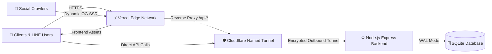

<div align="center">

# ✨ Sarawat Decha

**A cozy, modern web ecosystem built for the Student Inspector Organization**  
*Dechapattanayanukul School, Pattani, Thailand*

[](https://vercel.com)
[](https://cloudflare.com)
[](https://nodejs.org)
[-blue?style=flat-square&logo=sqlite)](https://sqlite.org)
[](https://www.sarawatdc.site)

---

</div>

## 🌿 Overview

**Sarawat Decha** is a lightweight, decoupled platform designed to power the daily operations, communication, and recruitment for Dechapattanayanukul School's student inspectors (Truant Patrol).

The project unifies public announcements, a real-time duty reservation system (**SI-ROSTER**), and an annual candidate admissions portal (**ADMISSION 70**) into a cohesive and joyful web experience.

---

## 🧁 System Architecture

The ecosystem relies on an edge-to-premise hybrid topology engineered for high availability and zero incoming port exposure:



### 🎀 Tech Stack

- **Client & Presentation:** Pure semantic HTML5, modern vanilla ES2022+, and the custom *Diego* Swiss-minimalist design system.
- **Edge Layer:** Vercel Edge CDN for global static delivery, bundled with lightweight Serverless Functions (`/api/*`) for on-demand Open Graph metadata rendering.
- **Gateway & Ingress:** Cloudflare Zero Trust Named Tunnel (`api.sarawatdc.site`), providing secure TLS termination and tunneling to on-premise infrastructure.
- **Backend Core:** Node.js Express micro-service handling RESTful endpoints, payload validation, and CORS policies.
- **Data Persistence:** Embedded SQLite engine utilizing Write-Ahead Logging (`WAL`) mode for robust, concurrent read-heavy performance.

---

## 🌸 Core Modules

| Module | Subsystem URL | Description |
| :--- | :--- | :--- |
| 🏛️ **Main Portal** | `sarawatdc.site` | Public presence, inspector hierarchy directory, activity showcase, and student feedback box. |
| 📋 **SI-ROSTER** | `sarawatdc.site/si-roster` | Real-time shift reservations, duty quota management, countdown timers, and personal schedule checks. |
| 🎒 **Admissions 70** | `admission.sarawatdc.site` | Candidate recruitment portal with academic GPAX qualification screening and live status tracker. |
| 🎛️ **Admin Cockpit** | `sarawatdc.site/admin` | Consolidated operations suite for scheduling, attendance records, feedback resolution, and applicant data review. |

---

## 📁 Repository Anatomy

```text
sarawat-home/
├── 📂 assets/              # Visual branding, covers, and school insignia
├── 📂 css/                 # Diego design system, typography, and theme styling
├── 📂 js/                  # Client-side API client, state, and tunnel configurations
│   ├── cloudflare-config.js # Centralized backend gateway definition
│   └── api-config.js        # Universal REST client & SDK methods
├── 📂 api/                 # Vercel serverless edge routes for dynamic crawler SSR
├── 📄 index.html           # Public landing & showcase portal
├── 📄 activities.html      # News archive & photo gallery
├── 📄 calendar.html        # Academic schedule & duty calendar
├── 📄 team.html            # Executive committee & member directory
├── 📄 admission.html       # Candidate recruitment & status tracking interface
├── 📄 admin.html           # Unified management & data export cockpit
└── ⚙️ vercel.json          # Edge routing, subdomain redirects & security headers
```

---

## ✨ Engineering Highlights

- 🍃 **Zero-Bloat Runtime:** Pure, uncompiled vanilla JavaScript without heavyweight framework dependencies for instant loading speed.
- 💬 **LINE In-App WebView Guard:** Automatic detection and breakout guidance for users opening links inside the LINE in-app browser.
- 🛡️ **A+ Security Standard:** Strict Content Security Policy (CSP), HTTP Strict Transport Security (HSTS), and fine-grained origin validation across all endpoints.
- ⚡ **Resilient Gateway Fallback:** Dual-mode networking capable of resolving requests directly through Cloudflare Tunnel or via Vercel Edge reverse proxy.

---

<div align="center">

*Crafted with care for the Student Inspector Organization*  
**Dechapattanayanukul School, Pattani, Thailand** 🇹🇭

</div>
