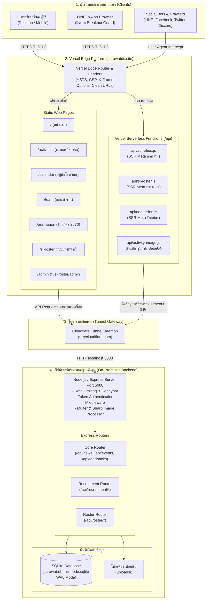
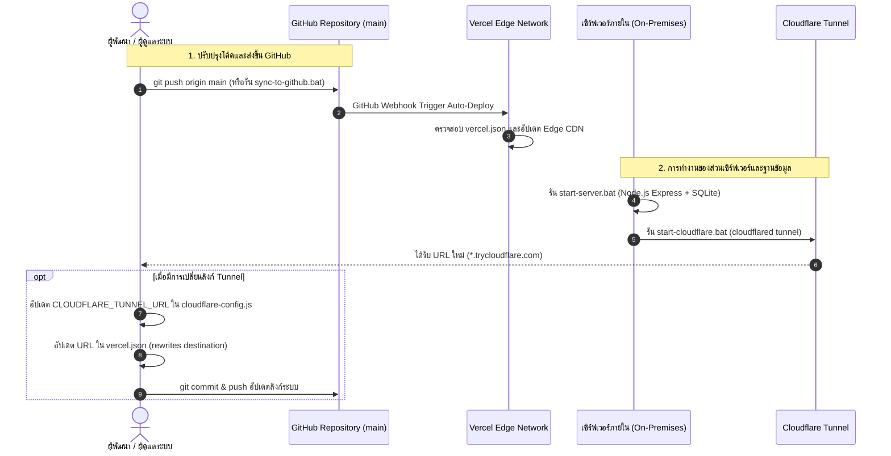

# 🛡️ SARAWAT DECHA — ระบบสารสนเทศและบริหารจัดการสารวัตรนักเรียน

เอกสารข้อมูลเชิงเทคนิคระดับ Production ของระบบสารสนเทศ คลังข่าวสาร ระบบลงหน้าที่ (SI-ROSTER) และระบบรับสมัครสารวัตรนักเรียน โรงเรียนเดชะปัตตนยานุกูล อำเภอเมืองปัตตานี จังหวัดปัตตานี

---

## 1. ชื่อโปรเจกต์และคำอธิบาย

**ชื่อโปรเจกต์:** SARAWAT DECHA (สารวัตรนักเรียน โรงเรียนเดชะปัตตนยานุกูล)  
**ชื่อองค์กร:** คณะสารวัตรนักเรียน โรงเรียนเดชะปัตตนยานุกูล (Student Inspector / Truant Patrol)  
**สังกัด:** กลุ่มงานกิจการนักเรียน โรงเรียนเดชะปัตตนยานุกูล  
**Repository:** [https://github.com/Pansamcth/sarawat-home](https://github.com/Pansamcth/sarawat-home)

ระบบนี้เป็นแพลตฟอร์มสารสนเทศสำหรับองค์กรสารวัตรนักเรียน พัฒนาขึ้นเพื่อให้บริการงานประชาสัมพันธ์กิจกรรม ข้อมูลระเบียบวินัย ระบบตารางปฏิบัติงานและลงชื่อปฏิบัติหน้าที่เวรประจำวัน (SI-ROSTER) ตลอดจนระบบรับสมัครสารวัตรนักเรียนรุ่นใหม่และการบริหารจัดการฐานข้อมูลสำหรับผู้ดูแลระบบ ผ่านสถาปัตยกรรมที่แยกส่วนระหว่าง Frontend บนระบบกระจายเนื้อหา (Static Hosting & Edge Serverless) และ Backend Service ที่เชื่อมต่อฐานข้อมูลภายในสถานศึกษา

---

## 2. ภาพรวมและวัตถุประสงค์ของระบบ

1. **ศูนย์กลางข้อมูลและประชาสัมพันธ์ (Public Experience Portal):** เผยแพร่ข่าวสาร ประกาศ กิจกรรม และทำเนียบคณะสารวัตรนักเรียนของโรงเรียน
2. **ระบบบริหารจัดการตารางเวรและลงหน้าที่ (SI-ROSTER):** จัดการกิจกรรมหน้าที่ประจำวัน จัดสรรกำลังพล ตรวจสอบโควตา และเปิดให้สารวัตรนักเรียนลงชื่อเข้าปฏิบัติหน้าที่พร้อมระบบประวัติย้อนหลัง
3. **ระบบรับสมัครสารวัตรนักเรียน (SARAWAT ADMISSIONS):** รับสมัครนักเรียนเข้าเป็นสารวัตรนักเรียนรุ่นใหม่ ตรวจสอบคุณสมบัติ เกรดเฉลี่ยสะสม (GPAX) สังกัดชุมนุม และตรวจสอบสถานะผลการสมัครออนไลน์
4. **ศูนย์ควบคุมและจัดการข้อมูล (Admin Management Cockpit):** แผงควบคุมสำหรับผู้ดูแลระบบและคณะกรรมการสารวัตรนักเรียนในการจัดการข่าวสาร ปฏิทิน คัดกรองผู้สมัคร และจัดการสิทธิ์

---

## 3. ลิงก์เว็บไซต์และระบบย่อย

| บริการ / ระบบย่อย | URL ทางการ | หน้าที่หลัก |
| :--- | :--- | :--- |
| **เว็บไซต์หลัก (Main Portal)** | [https://www.sarawatdc.site/](https://www.sarawatdc.site/) | หน้าแรก แนะนำองค์กร ประมวลผลงาน และช่องทางติดต่อ |
| **คลังข่าวสารและกิจกรรม** | [https://www.sarawatdc.site/activities](https://www.sarawatdc.site/activities) | ข่าวประชาสัมพันธ์ ประกาศ และประมวลภาพกิจกรรม |
| **ปฏิทินปฏิบัติงานโรงเรียน** | [https://www.sarawatdc.site/calendar](https://www.sarawatdc.site/calendar) | ปฏิทินกิจกรรมโรงเรียน วันสำคัญ และวันหยุด |
| **ทำเนียบคณะทำงาน** | [https://www.sarawatdc.site/team](https://www.sarawatdc.site/team) | โครงสร้างองค์กร คณะกรรมการ และสมาชิกแต่ละรุ่น |
| **ระบบลงหน้าที่ (SI-ROSTER)** | [https://www.sarawatdc.site/si-roster](https://www.sarawatdc.site/si-roster) | ระบบลงชื่อปฏิบัติหน้าที่ ตรวจสอบเวร และประวัติหน้าที่ |
| **ระบบรับสมัครสารวัตรนักเรียน** | [https://admission.sarawatdc.site/](https://admission.sarawatdc.site/) | ระบบรับสมัคร คัดกรอง และตรวจสอบสถานะผู้สมัคร |
| **แผงควบคุมหลัก (Unified Admin)** | [https://www.sarawatdc.site/admin](https://www.sarawatdc.site/admin) | จัดการข่าว ปฏิทิน คณะทำงาน รับสมัคร และกล่องข้อความ |
| **แผงควบคุม SI-ROSTER Admin** | [https://www.sarawatdc.site/si-roster/admin](https://www.sarawatdc.site/si-roster/admin) | จัดการตารางเวร รายชื่อนักเรียน และบันทึกประวัติหน้าที่ |

---

## 4. ภาพหน้าจอและสื่อในระบบ

ภาพหน้าปกและทรัพยากรภาพของระบบถูกจัดเก็บไว้ในไดเรกทอรี `assets/images/` และ `assets/icons/`:

| รายการภาพ | ตำแหน่งไฟล์ใน Repository | การใช้งาน |
| :--- | :--- | :--- |
| **โลโก้สารวัตรนักเรียน** | `assets/icons/sarawat-logo.png` | ตราสัญลักษณ์ทางการขององค์กรบน Header และ Favicon |
| **ตราโรงเรียน** | `assets/icons/school-logo.png` | ตราสัญลักษณ์โรงเรียนเดชะปัตตนยานุกูล |
| **ภาพหน้าแรก (Hero Cover)** | `assets/images/hero-main.jpg` | ภาพหน้าปกหลักส่วน Banner หน้าแรก |
| **ภาพหน้าปก SI-ROSTER** | `assets/images/si-roster-cover.jpg` | ภาพแบนเนอร์และภาพพรีวิวสำหรับ Open Graph ของระบบลงหน้าที่ |
| **ภาพหน้าปกรับสมัคร** | `assets/images/recruit-cover.jpg` | ภาพแบนเนอร์ระบบรับสมัครสารวัตรนักเรียน |
| **ภาพหน้าปกกิจกรรม** | `assets/images/activities-cover.jpg` | ภาพหน้าปกข่าวสารและภาพ Fallback เมื่อกิจกรรมไม่มีรูป |
| **ภาพหน้าปกปฏิทิน** | `assets/images/calendar-cover.jpg` | ภาพแบนเนอร์หน้าระบบปฏิทินปฏิบัติงาน |
| **ภาพหน้าปกทำเนียบทีม** | `assets/images/team-cover.jpg` | ภาพแบนเนอร์หน้าทำเนียบคณะทำงาน |

---

## 5. รายการฟีเจอร์และสถานะการพัฒนา

สถานะการพัฒนาจำแนกตามการตรวจสอบโค้ดจริงใน Repository ดังนี้:

| ฟังก์ชัน / ระบบย่อย | รายละเอียดฟีเจอร์ | สถานะการพัฒนา |
| :--- | :--- | :---: |
| **พอร์ทัลข่าวสารและกิจกรรม** | ค้นหา จัดหมวดหมู่ (`พิธีการสำคัญ`, `จิตอาสา`, `กิจกรรม`, `อบรมพัฒนา`) และเชื่อมต่อไปยังอัลบั้มภายนอก | **ใช้งานจริงและตรวจสอบแล้ว** |
| **ปฏิทินกิจกรรมโรงเรียน** | แสดงปฏิทินแบบ 7 วัน (อาทิตย์ - เสาร์) จัดหมวดหมู่วันสำคัญ/วันหยุด และระบุสถานะกิจกรรม | **ใช้งานจริงและตรวจสอบแล้ว** |
| **ทำเนียบสารวัตรนักเรียน** | แสดงโครงสร้างคณะกรรมการ ที่ปรึกษา และรายชื่อสมาชิกแยกรุ่น | **ใช้งานจริงและตรวจสอบแล้ว** |
| **กล่องรับฟังความคิดเห็น** | รับเรื่องร้องเรียนและข้อเสนอแนะ พร้อมสถานะติดตาม (`pending`, `in_progress`, `resolved`) | **ใช้งานจริงและตรวจสอบแล้ว** |
| **ระบบลงหน้าที่ (SI-ROSTER)** | สมัครเวรหน้าที่แบบนับจำนวนโควตาตามกิจกรรม พร้อมตัวนับถอยหลัง | **ใช้งานจริงและตรวจสอบแล้ว** |
| **ระบบเช็คหน้าที่ของฉัน** | ค้นหารายชื่อเพื่อดูหน้าที่ที่ตนเองได้รับมอบหมาย แยกแท็บ `[กำลังจะมาถึง]` และ `[ผ่านไปแล้ว]` | **ใช้งานจริงและตรวจสอบแล้ว** |
| **LINE WebView Breakout** | ตรวจจับการเปิดเว็บผ่านเบราว์เซอร์ภายในของแอปพลิเคชัน LINE และแนะนำให้เปิดในเบราว์เซอร์ระบบ | **ใช้งานจริงและตรวจสอบแล้ว** |
| **ระบบรับสมัคร 2570** | ฟอร์มลงทะเบียน 3 ขั้นตอน พร้อมตรวจสอบเกรดเฉลี่ยสะสม (GPAX), สังกัดชุมนุม และฐานข้อมูลที่อยู่ไทย | **ใช้งานจริงและตรวจสอบแล้ว** |
| **ตรวจสอบสถานะผู้สมัคร** | ค้นหาข้อมูลใบสมัครด้วยรหัสนักเรียนและระบบปลดล็อกแก้ไขข้อมูลส่วนบุคคล | **ใช้งานจริงและตรวจสอบแล้ว** |
| **Edge Open Graph SSR** | Serverless Function สกัดเมทาดาทาและสร้างแท็ก Open Graph / Twitter Card สำหรับบอตโซเชียลมีเดีย | **ใช้งานจริงและตรวจสอบแล้ว** |
| **แผงจัดการผู้ดูแลระบบ** | ตรวจสอบสิทธิ์ผู้ดูแลระบบแบบ Token-based รองรับบทบาท Superadmin และ Admin | **ใช้งานจริงและตรวจสอบแล้ว** |
| **ส่งออกข้อมูลผู้สมัคร** | สร้างไฟล์ Excel (`.xlsx`) สรุปรายชื่อผู้สมัครแยกตามสถานะและระดับชั้น | **ใช้งานจริงและตรวจสอบแล้ว** |
| **ระบบสุ่มหน้าที่ (Randomizer)** | อัลกอริทึมสุ่มจัดสรรสมาชิกเข้าประจำตำแหน่งหน้าที่ในกิจกรรม | **มีโค้ดแล้วแต่ยังไม่ได้ยืนยันการทำงาน** |
| **ส่งออกรายงานเวรเป็น PDF** | สร้างเอกสาร PDF สรุปรายชื่อผู้ปฏิบัติหน้าที่ด้วยฟอนต์ภาษาไทย | **มีโค้ดแล้วแต่ยังไม่ได้ยืนยันการทำงาน** |
| **เชื่อมต่อ Cloudflare Tunnel ถาวร** | การเปลี่ยนผ่านจาก Quick Tunnel (`trycloudflare.com`) ไปเป็น Named Cloudflare Tunnel พร้อมโดเมน CNAME เฉพาะ | **อยู่ระหว่างพัฒนา** |
| **ระบบแจ้งเตือนผ่าน LINE Notify / Bot** | ส่งข้อความแจ้งเตือนเมื่อมีการลงหน้าที่ใหม่หรือส่งใบสมัคร | **วางแผนในอนาคต** |
| **ฐานข้อมูลคลาวด์แบบ Fully Managed** | ย้ายฐานข้อมูลจากเครื่อง Local Node.js / SQLite ไปยัง Managed Database | **วางแผนในอนาคต** |

---

## 6. สถาปัตยกรรมระบบ (System Architecture)

ระบบ SARAWAT DECHA ใช้สถาปัตยกรรมแบบไฮบริด (Decoupled Hybrid Architecture):

- **ส่วนหน้าบ้าน (Frontend & Edge Routing):** โฮสต์ไฟล์สถิต (Static HTML/CSS/JS) บนโครงข่าย Edge ของ Vercel ร่วมกับ Vercel Serverless Functions (`/api/*`) สำหรับประมวลผลเมทาดาทาของ Social Media Crawlers
- **ระบบเครือข่ายความปลอดภัย (DNS & Tunnel Gateway):** ใช้ Cloudflare จัดการระเบียน DNS และใช้ Cloudflare Tunnel เพื่อเปิดช่องทางการเชื่อมต่อที่มีความปลอดภัยจากเครื่องเซิร์ฟเวอร์ภายในสู่ระบบภายนอก
- **ส่วนหลังบ้านและฐานข้อมูล (Backend Engine & SQLite Database):** รันบน Node.js / Express และ SQLite บนเซิร์ฟเวอร์ปฏิบัติการภายในสถานศึกษา



---

## 7. เทคโนโลยีที่ตรวจสอบแล้ว (Technology Stack)

### ฝั่งหน้าบ้าน (Frontend)
- **สถาปัตยกรรม:** HTML5 Semantic, Vanilla JavaScript (ES2022+), CSS3 (Modern Custom Properties / Bento Grid Layout)
- **ระบบรูปแบบและโทเคนดีไซน์:** Diego Minimalist Design System (`css/diego.css`)
- **การพิมพ์และฟอนต์:** Google Fonts (`Plus Jakarta Sans`, `Kanit`, `Outfit`)
- **ไอคอน:** Lucide Icons (CDN), FontAwesome 6 (CDN)
- **คอมโพเนนต์เสริม:** SweetAlert2 (v11), Marked.js, Toast UI Editor
- **สะพานเชื่อม API:** `js/api-config.js`, `js/cloudflare-config.js`, `js/bridge.js`

### ฝั่ง Serverless บน Edge (Vercel Functions)
- **สภาพแวดล้อมรันไทม์:** Node.js Serverless Function บน Vercel
- **ความสามารถ:** อ่านไฟล์ HTML ในเครื่องและแปลงแท็ก `<title>`, `<meta property="og:...">`, `<meta name="twitter:...">` แบบไดนามิกก่อนส่งออกไปยัง Web Crawlers

### ฝั่งหลังบ้าน (Backend Service)
- **รันไทม์:** Node.js (รองรับ v22+ ที่มีโมดูลในตัว `node:sqlite`)
- **เฟรมเวิร์ก:** Express.js (`v5.2.1`)
- **การจัดการไฟล์อัปโหลด:** Multer (`v2.4.0`)
- **การประมวลผลรูปภาพ:** Sharp (`v0.35.5`) แปลงและบีบอัดภาพให้อยู่ในรูปแบบ WebP/JPEG
- **การจัดการสเปรดชีต:** SheetJS / XLSX (`v0.18.5`) สำหรับส่งออกรายงานผู้สมัคร
- **ความปลอดภัยระบบเครือข่าย:** CORS (`v2.8.6`), Custom In-memory Sliding Window Rate Limiter, Honeypot Anti-Spam
- **สะพานเชื่อมเครือข่าย:** Cloudflare Tunnel (`cloudflared`) สำหรับเชื่อมต่อพอร์ต `5000` ไปยังเครือข่ายภายนอก

### ระบบฐานข้อมูล (Database Engine)
- **ระบบฐานข้อมูลหลัก:** SQLite (`sarawat.db`) ใช้งานผ่าน `node:sqlite` (`DatabaseSync`) ในโหมด Write-Ahead Logging (WAL)
- **ประเภทไฟล์จัดเก็บ:** ไฟล์ฐานข้อมูลเดี่ยวบนเซิร์ฟเวอร์ พร้อมโฟลเดอร์ไฟล์แนบรูปภาพ `uploads/`

---

## 8. โครงสร้างโปรเจกต์ (Project Structure)

```text
f:\MP\ (Root Repository)
├── .vercel/                        # ข้อมูลคอนฟิกของ Vercel CLI
├── api/                            # Vercel Serverless Functions สำหรับ Social Media Crawler SSR
│   ├── activities.js               # สกัดและแปลง Open Graph สำหรับหน้ารายละเอียดกิจกรรม
│   ├── activity-image.js           # ตัวกลางดึงและแปลง Base64 / ภาพกิจกรรมส่งต่อให้โปรแกรมแชต
│   ├── admission.js                # จัดการการเข้าถึงโดเมนย่อย admission.sarawatdc.site
│   ├── admissions.js               # รองรับเส้นทางพหูพจน์ (/admissions)
│   └── si-roster.js                # สกัดและแปลง Open Graph สำหรับกิจกรรมลงหน้าที่
│
├── assets/                         # ไฟล์ทรัพยากรภาพและข้อมูลสถิต
│   ├── data/
│   │   └── thai-address.json       # ฐานข้อมูลตำบล อำเภอ จังหวัด และรหัสไปรษณีย์ไทย
│   ├── icons/                      # ตราสัญลักษณ์และไอคอนองค์กร
│   └── images/                     # ภาพหน้าปกหลักและภาพกิจกรรมเริ่มต้น
│
├── css/                            # สไตล์ชีตหลักของระบบ
│   ├── diego.css                   # ระบบโทเคนดีไซน์และเลย์เอาต์สไตล์ Diego Minimalist
│   ├── roster.css                  # สไตล์ชีตสำหรับคอมโพเนนต์ลงหน้าที่
│   ├── style.css                   # สไตล์ชีตทั่วไป
│   └── team-page.css               # สไตล์ชีตเฉพาะหน้าทำเนียบคณะทำงาน
│
├── js/                             # สคริปต์การทำงานฝั่งไคลเอนต์
│   ├── admin-recruitment.js        # ตรรกะการคัดกรองและจัดการผู้สมัครในหน้า Admin
│   ├── admin-team.js               # ตรรกะจัดการทำเนียบคณะทำงาน
│   ├── api-config.js               # ศูนย์รวมการเรียก API (`window.SarawatApi`)
│   ├── bridge.js                   # ตัวแปลงคำสั่ง `google.script.run` ให้เป็น HTTP POST
│   ├── cloudflare-config.js        # จุดระบุ URL ของ Cloudflare Tunnel สำหรับหน้าหลัก
│   ├── image-protection.js         # ป้องกันการคัดลอกและบันทึกภาพที่ไม่ได้รับอนุญาต
│   ├── main.js                     # ตรรกะทั่วไปของหน้าเว็บและแถบนำทาง
│   ├── roster.js                   # สคริปต์ฟังก์ชันลงหน้าที่
│   └── skeletons.js                # ฟังก์ชันสร้าง Shimmer Skeleton ระหว่างรอโหลดข้อมูล
│
├── SI-ROSTER/                      # ระบบย่อย SI-ROSTER
│   ├── admin.html                  # แผงควบคุมระบบลงหน้าที่สำหรับกรรมการสารวัตรนักเรียน
│   ├── index.html                  # หน้าลงชื่อปฏิบัติหน้าที่และตรวจสอบหน้าที่สำหรับสมาชิก
│   ├── css/style.css               # สไตล์ชีตเฉพาะของ SI-ROSTER
│   └── js/
│       ├── app.js                  # ตรรกะปฏิทินและบันทึกเวรของระบบเดิม
│       ├── bridge.js               # ตัวแปลง Proxy API เฉพาะโฟลเดอร์ SI-ROSTER
│       └── line-browser-guard.js   # ตรวจจับและนำผู้ใช้เปิดภายนอกแอป LINE
│
├── activities.html                 # หน้าคลังข่าวสารและกิจกรรม
├── admin.html                      # หน้าแผงควบคุมระบบหลัก (Unified Admin)
├── admission.html                  # หน้าระบบรับสมัครสารวัตรนักเรียน ปีการศึกษา 2570
├── calendar.html                   # หน้าปฏิทินกิจกรรมโรงเรียน
├── cloudflare-config.js            # ไฟล์คอนฟิกลิงก์ Tunnel สำหรับโฟลเดอร์ราก
├── index.html                      # หน้าแรกของเว็บไซต์ (Landing Page)
├── llms.txt                        # ข้อมูลสรุปย่อของเว็บไซต์สำหรับระบบปัญญาประดิษฐ์
├── llms-full.txt                   # ข้อมูลองค์กรและโครงสร้างเว็บฉบับเต็มสำหรับ LLMs
├── robots.txt                      # ข้อกำหนดการเก็บข้อมูลของ Web Crawler
├── sitemap.xml                     # แผนผังเว็บไซต์สำหรับการทำดัชนีของ Search Engine
├── sync-to-github.bat              # สคริปต์ Windows Batch สำหรับ Push โค้ดขึ้นทุก Branch พร้อมกัน
├── team.html                       # หน้าทำเนียบสารวัตรนักเรียน
└── vercel.json                     # การตั้งค่า Vercel Edge (Security Headers, Routing, Rewrites)
```

---

## 9. ข้อกำหนดเบื้องต้น (Prerequisites)

- **ระบบปฏิบัติการ:** Windows 10/11, macOS หรือ Linux
- **Node.js:** เวอร์ชัน `22.x` ขึ้นไป (เนื่องจากใช้โมดูลมาตรฐาน `node:sqlite`)
- **เว็บเซิร์ฟเวอร์แบบสถิต (สำหรับ Frontend):** Python 3 (`http.server`), Node.js (`npx serve`) หรือ Live Server บน VS Code
- **Cloudflare Tunnel Client:** โปรแกรม `cloudflared` (กรณีต้องการเชื่อมต่อเซิร์ฟเวอร์เครื่องภายในเข้าสู่ระบบเครือข่ายจริง)

---

## 10. ขั้นตอนการติดตั้งและรัน Frontend

เนื่องจากส่วนหน้าบ้านของโครงการนี้พัฒนาด้วย Vanilla JavaScript และ HTML5 โดยไม่มีกระบวนการ Build หรือ Bundler จึงสามารถรันได้ทันที:

```bash
# 1. โคลน Repository
git clone https://github.com/Pansamcth/sarawat-home.git
cd sarawat-home

# 2. เรียกใช้งานเว็บเซิร์ฟเวอร์แบบสถิต
# ทางเลือกที่ 1: ผ่าน Python 3
python -m http.server 8080

# ทางเลือกที่ 2: ผ่าน Node.js npx serve
npx serve . -p 8080
```

เปิดเบราว์เซอร์ไปที่ `http://localhost:8080`

---

## 11. ขั้นตอนการติดตั้งและรัน Backend

บริการส่วนหลังบ้าน (`sarawat-backend`) ทำหน้าที่ให้บริการ API และเชื่อมต่อฐานข้อมูล SQLite:

```bash
# 1. เข้าสู่โฟลเดอร์ Backend
cd C:/Users/Administrator/Desktop/sarawat-backend

# 2. ติดตั้ง Dependencies (Express, Multer, Sharp, XLSX, CORS)
npm install

# 3. เริ่มต้นการทำงานของเซิร์ฟเวอร์
node server.js
```

หรือเปิดทำงานอัตโนมัติบนระบบปฏิบัติการ Windows:
- ดับเบิลคลิก `START-ALL.bat` เพื่อเปิดทั้ง **Server Logs Engine** และ **Dashboard Monitor**

---

## 12. การตั้งค่าตัวแปรและการกำหนดค่าระบบ (Configuration)

### ฝั่งหน้าบ้าน (Frontend Configuration)
ตั้งค่าผ่านไฟล์ `cloudflare-config.js` (และ `SI-ROSTER/js/bridge.js`):
- `CLOUDFLARE_TUNNEL_URL`: ระบุ URL ของ Cloudflare Tunnel เช่น `https://xxxx.trycloudflare.com` โดยฟังก์ชัน `resolveApiBase()` จะตรวจสอบสภาพแวดล้อมการเข้าถึงอัตโนมัติ:
  - หากเปิดจาก `localhost` จะใช้ `http://localhost:5000`
  - หากเปิดจากเครือข่ายวงแลน (LAN) จะใช้พอร์ต `5000` ของเครื่อง Host
  - หากเปิดจากภายนอกหรือ Vercel จะใช้ลิงก์ `CLOUDFLARE_TUNNEL_URL`

### ฝั่ง Vercel Edge (`vercel.json`)
- มีกฎการเขียนทับเส้นทาง (Rewrites) สำหรับส่งต่อคำขอ `/api/:path*` และ `/uploads/:path*` ไปยัง URL ของ Cloudflare Tunnel:
```json
{
  "source": "/api/:path*",
  "destination": "https://prototype-sampling-fees-buy.trycloudflare.com/api/:path*"
}
```

### ฝั่งหลังบ้าน (Backend Configuration)
- `PORT`: หมายเลขพอร์ตที่ให้บริการ (ค่าเริ่มต้น: `5000`)
- `sarawat.db`: ฐานข้อมูล SQLite จัดเก็บไว้ในโฟลเดอร์รากของ Backend
- `uploads/`: โฟลเดอร์จัดเก็บไฟล์รูปภาพที่ผู้ใช้อัปโหลด

---

## 13. เอกสาร API (API Documentation)

บริการหลังบ้านเปิดให้บริการ Endpoint โดยแบ่งตามกลุ่มระบบงาน ดังนี้:

### 13.1 กลุ่มระบบหลักและประชาสัมพันธ์ (Core & Public APIs)

| Method | Endpoint | สิทธิ์การเข้าถึง | รายละเอียดคำขอ / ข้อมูลส่งออก |
| :--- | :--- | :---: | :--- |
| `GET` | `/api/health` | สาธารณะ | ตรวจสอบสถานะการเชื่อมต่อของเซิร์ฟเวอร์ |
| `GET` | `/api/news` | สาธารณะ | ดึงรายการข่าวสารและประกาศทั้งหมด |
| `POST` | `/api/news` | ต้องล็อกอิน (Admin) | เพิ่ม/แก้ไขข่าวสาร (Body: `{ id, tag, title, date, desc, image }`) |
| `DELETE` | `/api/news/:id` | ต้องล็อกอิน (Admin) | ลบรายการข่าวสารตาม ID |
| `GET` | `/api/events` | สาธารณะ | ดึงรายการกิจกรรมและปฏิทินโรงเรียน |
| `POST` | `/api/events` | ต้องล็อกอิน (Admin) | เพิ่ม/แก้ไขกิจกรรมปฏิทิน |
| `DELETE` | `/api/events/:id` | ต้องล็อกอิน (Admin) | ลบกิจกรรมปฏิทินตาม ID |
| `POST` | `/api/upload` | ต้องล็อกอิน (Admin) | อัปโหลดรูปภาพ (Multipart Form: `image` แปลงผ่าน Sharp) |
| `POST` | `/api/feedbacks` | สาธารณะ (มี Rate Limit) | ส่งข้อคิดเห็น/ข้อร้องเรียน (พร้อม Honeypot Field `website_hp`) |
| `GET` | `/api/feedbacks` | ต้องล็อกอิน (Admin) | เรียกดูรายการข้อคิดเห็นทั้งหมด |
| `PATCH` | `/api/feedbacks/:id` | ต้องล็อกอิน (Admin) | อัปเดตสถานะข้อคิดเห็น (`status`, `adminNotes`) |

### 13.2 กลุ่มยืนยันตัวตนผู้ดูแลระบบ (Authentication APIs)

| Method | Endpoint | สิทธิ์การเข้าถึง | รายละเอียดคำขอ / ข้อมูลส่งออก |
| :--- | :--- | :---: | :--- |
| `GET` | `/api/admins/setup-status` | สาธารณะ | ตรวจสอบว่าระบบมีผู้ดูแลระบบคนแรกแล้วหรือไม่ |
| `POST` | `/api/admins/setup` | สาธารณะ (เฉพาะครั้งแรก) | สร้างผู้ดูแลระบบระดับ Super Admin คนแรก |
| `POST` | `/api/login` | สาธารณะ (จำกัด 5 ครั้ง/15 นาที) | ล็อกอิน (Body: `{ username, password }`) คืนค่า `{ success, token, user, role }` |
| `POST` | `/api/logout` | ต้องล็อกอิน | ออกจากระบบและยกเลิก Session Token |
| `GET` | `/api/auth/verify` | ต้องมี Header Token | ตรวจสอบความถูกต้องของ Session Token ปัจจุบัน |
| `GET` | `/api/admins` | Super Admin เท่านั้น | ดึงรายชื่อบัญชีผู้ดูแลระบบทั้งหมด |
| `POST` | `/api/admins` | Super Admin เท่านั้น | เพิ่มบัญชีผู้ดูแลระบบใหม่ |
| `DELETE` | `/api/admins/:id` | Super Admin เท่านั้น | ลบบัญชีผู้ดูแลระบบ |

### 13.3 กลุ่มระบบรับสมัครสารวัตรนักเรียน (Recruitment APIs)

| Method | Endpoint | สิทธิ์การเข้าถึง | รายละเอียดคำขอ / ข้อมูลส่งออก |
| :--- | :--- | :---: | :--- |
| `GET` | `/api/recruitment/status` | สาธารณะ | ตรวจสอบสถานะการเปิด/ปิดรับสมัคร และเงื่อนไข GPAX |
| `GET` | `/api/recruitment/clubs` | สาธารณะ | ดึงรายชื่อชุมนุมและสังกัดที่เปิดรับสมัคร |
| `POST` | `/api/recruitment/apply` | สาธารณะ (มี Rate Limit) | ส่งใบสมัคร (Multipart Form: ข้อมูลส่วนตัว, ที่อยู่, รูปถ่ายหน้าตรง) |
| `GET` | `/api/recruitment/check-status/:studentId` | สาธารณะ | ตรวจสอบสถานะใบสมัครด้วยเลขประจำตัวนักเรียน |
| `POST` | `/api/recruitment/unlock-correction` | สาธารณะ | ยืนยันตัวตนด้วยเลขนักเรียนและเบอร์โทรเพื่อขอสิทธิ์แก้ไขใบสมัคร |
| `PUT` | `/api/recruitment/correction/:studentId` | สาธารณะ | ส่งข้อมูลใบสมัครฉบับแก้ไข |
| `GET` | `/api/recruitment/stats` | ต้องล็อกอิน (Admin) | สรุปสถิติผู้สมัครแยกตามสถานะและระดับชั้น |
| `GET` | `/api/recruitment/applicants` | ต้องล็อกอิน (Admin) | รายการผู้สมัครทั้งหมด รองรับการค้นหา กรอง และแบ่งหน้า |
| `PUT` | `/api/recruitment/applicant/:id/status` | ต้องล็อกอิน (Admin) | เปลี่ยนสถานะใบสมัคร (`approved`, `rejected`, `need_correction`) |
| `GET` | `/api/recruitment/export` | ต้องล็อกอิน (Admin) | ดาวน์โหลดสเปรดชีต Excel (`.xlsx`) ข้อมูลผู้สมัคร |

### 13.4 กลุ่มระบบลงหน้าที่ (SI-ROSTER APIs)

คำขอทั้งหมดถูกส่งผ่าน HTTP POST มายัง Endpoint `/api/roster/:method` โดยมีโครงสร้าง Body เป็น `{ args: [ ... ] }` เพื่อรองรับคำสั่งเดิมของ `google.script.run`:

| Method Name | อาร์กิวเมนต์ที่ส่ง | สิทธิ์ | คำอธิบายการทำงาน |
| :--- | :--- | :---: | :--- |
| `getAppInitData` | ไม่มี | สมาชิก | ดึงค่าคอนฟิก ประเภทหน้าที่ รายชื่อนักเรียน และกิจกรรมที่กำลังจะมาถึง |
| `getAllActivities` | ไม่มี | สมาชิก | ดึงรายการกิจกรรมหน้าที่ทั้งหมด |
| `getSignupsForActivity` | `sheetName` | สมาชิก | ดึงรายชื่อผู้ลงทะเบียนในกิจกรรมที่ระบุ |
| `saveSignup` | `sheetName, name, duty, studentObj, optAdmin` | สมาชิก/Admin | บันทึกการลงชื่อปฏิบัติหน้าที่ พร้อมตรวจสอบโควตาและเวลาหมดเขต |
| `deleteSignup` | `sheetName, id` | Admin | ลบรายการลงทะเบียนหน้าที่ของนักเรียน |
| `bulkDeleteSignups` | `sheetName, ids` | Admin | ลบรายการลงทะเบียนหลายรายการพร้อมกัน |
| `checkStudentStatus` | `studentName` | สมาชิก | ตรวจสอบรายการหน้าที่ของนักเรียนรายบุคคล (แยกกำลังจะมาถึงและที่ผ่านมาแล้ว) |
| `getAllUpcomingSignups` | ไม่มี | Admin | แสดงรายชื่อผู้ลงทะเบียนของทุกกิจกรรมที่กำลังจะมาถึง |
| `saveActivity` | `activityData` | Admin | สร้างหรือแก้ไขข้อมูลกิจกรรมหน้าที่ |
| `deleteActivity` | `sheetName` | Admin | ลบกิจกรรมหน้าที่ออกจากระบบ |
| `randomizeSignups` | `sheetName, duty, count` | Admin | สุ่มจัดสรรรายชื่อนักเรียนลงตำแหน่งหน้าที่ที่ยังว่าง |

---

## 14. การยืนยันตัวตนและการกำหนดสิทธิ์ผู้ดูแลระบบ

### ระดับสิทธิ์ในระบบ (Role-Based Access Control)
1. **บุคคลทั่วไป / นักเรียนทั่วไป (Public / Students):**
   - เข้าถึงหน้าประชาสัมพันธ์ ส่งข้อเสนอแนะ ค้นหาหน้าที่ตนเอง และส่งใบสมัคร
   - มีระบบ Rate Limiting และ Honeypot เพื่อป้องกันสแปม
2. **สารวัตรนักเรียน / ผู้ปฏิบัติงาน (Prefect Members):**
   - ลงชื่อปฏิบัติหน้าที่ในระบบ SI-ROSTER ตามรายชื่อนักเรียนที่มีในฐานข้อมูล
3. **ผู้ดูแลระบบ (Admin):**
   - จัดการกิจกรรม ข่าวสาร คัดกรองและปรับสถานะผู้สมัคร จัดการตารางเวร
4. **ผู้ดูแลระบบสูงสุด (Super Admin):**
   - สิทธิ์เต็มทุกระบบ รวมถึงการจัดการเพิ่ม/ลบ และรีเซ็ตรหัสผ่านของผู้ดูแลระบบคนอื่น

### กลไกความปลอดภัยฝั่งเซิร์ฟเวอร์ (Server-side Authentication)
- เมื่อเข้าสู่ระบบสำเร็จ เซิร์ฟเวอร์จะสร้าง Session Token ความยาว 64 ไบต์แบบสุ่ม (`crypto.randomBytes(32).toString('hex')`) และบันทึกลงในตาราง `admin_sessions` กำหนดเวลาหมดอายุ 24 ชั่วโมง
- ทุกคำขอที่ต้องการสิทธิ์ Admin จะต้องส่ง Header `Authorization: Bearer <token>`
- **ข้อสำคัญ:** การซ่อนปุ่มหรือซ่อนแท็บบนหน้าเว็บ (เช่น `style="display:none;"`) เป็นเพียงการอำนวยความสะดวกในการแสดงผลแก่ผู้ใช้ การรักษาความปลอดภัยที่แท้จริงดำเนินการผ่าน Middleware `authenticateAdmin` และ `requireSuperAdmin` ฝั่งเซิร์ฟเวอร์เท่านั้น

---

## 15. การตั้งค่าระบบเครือข่าย Cloudflare และ Vercel

### Cloudflare (Free Tier)
- **การจัดการโดเมนและ DNS:** ชี้ระเบียง A/CNAME ของโดเมนหลัก `sarawatdc.site` และโดเมนย่อย `admission.sarawatdc.site` ไปยัง Vercel
- **Cloudflare Tunnel (`cloudflared`):** สร้างช่องทางเชื่อมต่อเสมือนแบบเข้ารหัส (Encrypted Tunnel) จากเครื่องเซิร์ฟเวอร์ภายในสถานศึกษา ส่งผ่านพอร์ต `5000` ไปยังเครือข่ายภายนอกโดยไม่ต้องทำ Port Forwarding บนเราเตอร์โรงเรียน

### Vercel Platform
- **Static Hosting & CDN Caching:** โฮสต์และกระจายไฟล์ HTML/CSS/JS และ Assets ไปยัง Edge Data Centers ทั่วโลก
- **Security Headers (`vercel.json`):**
  - `Content-Security-Policy`: ควบคุมแหล่งที่มาของสคริปต์ สไตล์ และการเชื่อมต่อ API
  - `Strict-Transport-Security`: บังคับใช้งาน HTTPS พร้อม preload
  - `X-Frame-Options: SAMEORIGIN`: ป้องกันการโจมตีประเภท Clickjacking
  - `X-Content-Type-Options: nosniff`: บังคับปฏิบัติตาม MIME Type ที่ถูกต้อง
- **Reverse Proxy & Edge Rewrites:** ส่งต่อคำขอ API (`/api/*`) ไปยังที่อยู่ Tunnel ของเซิร์ฟเวอร์หลังบ้าน

---

## 16. โครงสร้างฐานข้อมูล (Database Schema)

ระบบใช้งานฐานข้อมูล SQLite (`sarawat.db`) โดยมีตารางที่ตรวจสอบแล้วจำนวน 20 ตาราง:

```text
                                [sarawat.db - SQLite Schema]

  +-----------------------+       +-------------------------+       +------------------------+
  |         news          |       |         events          |       |     featured_event     |
  +-----------------------+       +-------------------------+       +------------------------+
  | id (TEXT PK)          |       | id (TEXT PK)            |       | id (INTEGER PK)        |
  | tag (TEXT)            |       | day, month, weekday     |       | title, desc, location  |
  | title (TEXT)          |       | category, category_label|       | date_start, date_end   |
  | desc, image (TEXT)    |       | title, time, location   |       | updated_at (TEXT)      |
  | views (INTEGER)       |       | date_start, date_end    |       +------------------------+
  | created_at, updated_at|       | created_at (TEXT)       |
  +-----------------------+       +-------------------------+

  +-----------------------+       +-------------------------+       +------------------------+
  |        admins         |       |     admin_sessions      |       |        settings        |
  +-----------------------+       +-------------------------+       +------------------------+
  | id (INTEGER PK)       |       | token (TEXT PK)         |       | setting_key (TEXT PK)  |
  | username (TEXT)       |       | admin_id (INTEGER)      |       | setting_value (TEXT)   |
  | password (TEXT)       |       | username, role (TEXT)   |       +------------------------+
  | role (TEXT)           |       | expires_at, created_at  |
  +-----------------------+       +-------------------------+

  +-----------------------+       +-------------------------+       +------------------------+
  |       feedbacks       |       |  recruitment_settings   |       |   recruitment_clubs    |
  +-----------------------+       +-------------------------+       +------------------------+
  | id (TEXT PK)          |       | id (INTEGER PK)         |       | id (INTEGER PK)        |
  | type, category (TEXT) |       | academic_year, is_open  |       | type, name (TEXT)      |
  | title, detail (TEXT)  |       | start_datetime, end_date|       | quota, is_active (INT) |
  | sender_name, contact  |       | min_gpax (REAL)         |       | created_at (TEXT)      |
  | status, admin_notes   |       | allowed_grades (TEXT)   |       +------------------------+
  +-----------------------+       +-------------------------+

  +------------------------------------------------------------------------------------------+
  |                                        applicants                                        |
  +------------------------------------------------------------------------------------------+
  | id (INTEGER PK)                                                                          |
  | application_code, student_id, prefix, first_name, last_name, grade_level, classroom (TEXT)|
  | phone, gpax (REAL), club, affiliation, photo_url (TEXT)                                  |
  | house_no, village_no, building, soi, road, subdistrict, district, province, postal_code   |
  | pdpa_consent (INT), consent_timestamp, status, admin_notes, correction_note, created_at   |
  +------------------------------------------------------------------------------------------+
          |
          +---> applicant_status_history (id, applicant_id, previous_status, new_status, changed_by)
          +---> recruitment_logs (id, action, actor, target_id, details, ip_address, created_at)

  +------------------------------------------------------------------------------------------+
  |                                    roster_activities                                     |
  +------------------------------------------------------------------------------------------+
  | id (INTEGER PK)                                                                          |
  | date, title, description, duties (JSON/TEXT), sheet_name, deadline, start_time, view_mode|
  | end_date, allow_multiple_duties (INT), creator_name                                      |
  +------------------------------------------------------------------------------------------+
          |
          +---> roster_signups (id, activity_id, duty_name, student_name, student_grade, timestamp)
          +---> roster_activity_logs (id, admin_name, action_type, activity_name, details, timestamp)

  +-----------------------+       +-------------------------+       +------------------------+
  |    roster_students    |       |      roster_duties      |       |     roster_admins      |
  +-----------------------+       +-------------------------+       +------------------------+
  | id (INTEGER PK)       |       | id (INTEGER PK)         |       | id (INTEGER PK)        |
  | name (TEXT)           |       | name (TEXT)             |       | username, password     |
  | grade (TEXT)          |       | quota, order_index (INT)|       | name, role (TEXT)      |
  +-----------------------+       +-------------------------+       +------------------------+
```

---

## 17. การสำรองและการกู้คืนข้อมูล (Backup & Restore)

1. **การสำรองข้อมูลระดับฐานข้อมูล SQLite:**
   - คัดลอกไฟล์ `sarawat.db` ร่วมกับไฟล์ WAL (`sarawat.db-wal`, `sarawat.db-shm`) ในขณะที่เซิร์ฟเวอร์ปิดการทำงาน หรือใช้คำสั่ง SQLite Backup API:
     ```bash
     sqlite3 sarawat.db ".backup 'sarawat-backup.db'"
     ```
   - ในโฟลเดอร์เซิร์ฟเวอร์มีไฟล์สำรอง `sarawat.db.bak` ที่สร้างขึ้นก่อนหน้า
2. **การสำรองข้อมูลผ่านหน้าแผงควบคุม Admin (`tab-backup`):**
   - ผู้ดูแลระบบสามารถกดปุ่มส่งออกข้อมูลเป็นไฟล์ JSON ได้แก่ ข้อมูลข่าวสาร กิจกรรมปฏิทิน และการตั้งค่าระบบ
   - การกู้คืนสามารถนำเข้าไฟล์ JSON เพื่ออัปเดตข้อมูลกลับสู่ตารางได้ทันที

---

## 18. วิธีทดสอบระบบ (System Testing)

1. **การตรวจสอบสถานะเซิร์ฟเวอร์ (Health Check):**
   ```bash
   curl -i http://localhost:5000/api/health
   # ผลลัพธ์ที่คาดหวัง: HTTP 200 OK พร้อมสถานะ uptime และ database status
   ```
2. **การทดสอบ API รับสมัคร (Recruitment Status):**
   ```bash
   curl -i http://localhost:5000/api/recruitment/status
   ```
3. **การทดสอบสะพานเชื่อม SI-ROSTER (Roster Bridge):**
   ```bash
   curl -X POST http://localhost:5000/api/roster/getAppInitData \
     -H "Content-Type: application/json" \
     -d "{\"args\":[]}"
   ```
4. **การทดสอบความถูกต้องของสคริปต์ใน Repository:**
   - ภายในไดเรกทอรี `scratch/` มีสคริปต์ทดสอบอัตโนมัติ เช่น `test-api.js`, `test_roster_execution.js`, และ `test_recruit_comprehensive.js`

---

## 19. การแก้ไขปัญหาและข้อผิดพลาดที่พบบ่อย (Troubleshooting)

| อาการ / ข้อผิดพลาด | สาเหตุที่เป็นไปได้ | แนวทางแก้ไข |
| :--- | :--- | :--- |
| **หน้าเว็บขึ้นเตือน "ไม่พบการเชื่อมต่อเซิร์ฟเวอร์"** | 1. เซิร์ฟเวอร์ Node.js พอร์ต `5000` ไม่ได้เปิด<br>2. Cloudflare Tunnel ปิดหรือลิงก์เปลี่ยน | 1. ตรวจสอบว่า `server.js` กำลังทำงานอยู่<br>2. ตรวจสอบหน้าต่าง `cloudflared` และนำ URL ใหม่มาใส่ใน `cloudflare-config.js` |
| **พอร์ต 5000 ชน (EADDRINUSE)** | มีโพรเซส Node.js เก่าค้างทำงานอยู่ | เซิร์ฟเวอร์มีระบบตรวจจับและสั่งปิด PID เก่าอัตโนมัติ หากยังติดขัดให้ใช้คำสั่ง `taskkill /f /im node.exe` |
| **รูปภาพกิจกรรมหรือรูปผู้สมัครไม่แสดงผล** | ลิงก์รูปภาพในฐานข้อมูลเป็นลิงก์ Discord เก่าที่หมดอายุ | ระบบมีฟังก์ชัน Fallback สลับไปใช้ `assets/images/activities-cover.jpg` อัตโนมัติ ให้ทำการอัปโหลดรูปภาพใหม่ผ่านระบบหลังบ้าน |
| **ผู้ใช้เปิดผ่านแอป LINE แล้วระบบรีเฟรชหรือหลุดจากฟอร์ม** | เบราว์เซอร์ภายในแอป LINE (In-App WebView) มีข้อจำกัดเรื่องคุกกี้ | ระบบมีสคริปต์ `line-browser-guard.js` คอยแนะนำให้ผู้ใช้กดจุดสามจุดแล้วเลือก "เปิดด้วยเบราว์เซอร์เริ่มต้น" |
| **Social Media แสดงภาพพรีวิวไม่ตรงกับกิจกรรม** | Social Crawlers ไม่ได้ประมวลผล JavaScript ฝั่งไคลเอนต์ | ตรวจสอบว่า Vercel Serverless Function (`api/activities.js`, `api/si-roster.js`) ทำงานปกติ และรูปภาพมีขนาดไม่เกิน 1 MB ตามเกณฑ์ของ LINE/Facebook |

---

## 20. ขั้นตอนการนำขึ้นระบบจริง (Deployment Workflow)



---

## 21. ข้อเสนอแนะด้านความปลอดภัยและข้อจำกัดที่ทราบ (Security & Limitations)

### ข้อพิจารณาและข้อเสนอแนะด้านความปลอดภัย (Security Recommendations)
1. **การอัปเดตลิงก์ Cloudflare Tunnel ด้วยตนเอง:** การใช้ Quick Tunnel แบบสุ่ม (`*.trycloudflare.com`) จำเป็นต้องอัปเดตไฟล์คอนฟิกเมื่อเปิดเครื่องใหม่ **ข้อเสนอแนะ:** ควรเปลี่ยนไปใช้ **Named Tunnel (Cloudflare Zero Trust)** พร้อมผูกโดเมนย่อยถาวร เช่น `api.sarawatdc.site` เพื่อลดความผิดพลาดและไม่ต้องแก้ไขโค้ดเมื่อเซิร์ฟเวอร์รีสตาร์ท
2. **การรวมศูนย์ระบบจัดการบัญชีผู้ดูแลระบบ (Authentication Unification):** ปัจจุบันระบบหลักใช้ตาราง `admins` และ `admin_sessions` ในขณะที่ระบบตารางเวรเดิมมีตาราง `roster_admins` **ข้อเสนอแนะ:** ควรรวมการตรวจสอบสิทธิ์ให้ใช้ Session Token ชุดเดียวกันทั้งหมด
3. **การปกป้องข้อมูลส่วนบุคคลของนักเรียน (PDPA Compliance):** ฐานข้อมูลมีการจัดเก็บเลขประจำตัวนักเรียนและเบอร์โทรศัพท์สำหรับตรวจสอบสถานะใบสมัคร ควรหมั่นสำรวจสิทธิ์การเข้าถึง Endpoint สำหรับดาวน์โหลดรายงาน (`/api/recruitment/export`) ให้อยู่ภายใต้การยืนยันตัวตนระดับ Admin เท่านั้น
4. **ข้อจำกัดในการรับโหลดพร้อมกันสูง (Concurrency on Peak Hours):** ฐานข้อมูล SQLite แม้จะเปิดโหมด WAL แต่หากมีผู้ใช้งานลงทะเบียนเวรพร้อมกันจำนวนมากในเสี้ยววินาทีเดียวกัน อาจเกิดปัญหาคิวเขียนข้อมูล (Write Lock) ควรพิจารณานำระบบคิวคำขอ (Queueing Mechanism) มาช่วยจัดการการบันทึกข้อมูลในกิจกรรมที่มีการแย่งชิงโควตาสูง

---

## 22. ผู้พัฒนาและลิขสิทธิ์ (Credits, Maintainers & License)

### คณะทำงานผู้พัฒนาและดูแลระบบ
พัฒนาและดูแลรักษาโดย **ฝ่ายเทคโนโลยีสารสนเทศและดิจิทัล (IT & Digital Technology Division)**  
คณะสารวัตรนักเรียน โรงเรียนเดชะปัตตนยานุกูล จังหวัดปัตตานี

- **หัวหน้านักพัฒนาและสถาปัตยกรรมระบบ:** รุจิระ วัฒนกิจไพศาล ([@Pansamcth](https://github.com/Pansamcth))
- **อีเมลติดต่อ:** `rujira.wattanakitpaisal@gmail.com`
- **ที่อยู่:** โรงเรียนเดชะปัตตนยานุกูล เลขที่ 8 ถนนหนองจิก ตำบลสะบารัง อำเภอเมืองปัตตานี จังหวัดปัตตานี 94000
- **ช่องทางโซเชียลมีเดีย:**
  - Facebook: [สารวัตรนักเรียน โรงเรียนเดชะปัตตนยานุกูล](https://web.facebook.com/sarawatdechaa)
  - Instagram: [@sarawat_decha](https://www.instagram.com/sarawat_decha/)

---

### ลิขสิทธิ์การใช้งาน (License)

สงวนลิขสิทธิ์ &copy; 2569–2570 **คณะสารวัตรนักเรียน โรงเรียนเดชะปัตตนยานุกูล**  
ห้ามคัดลอก ดัดแปลง แจกจ่าย หรือนำซอร์สโค้ดและทรัพยากรภาพของระบบไปใช้งานในเชิงพาณิชย์ หรือนำไปใช้ภายนอกกิจการของโรงเรียนเดชะปัตตนยานุกูล โดยไม่ได้รับความยินยอมเป็นลายลักษณ์อักษรจากองค์กรผู้พัฒนา
